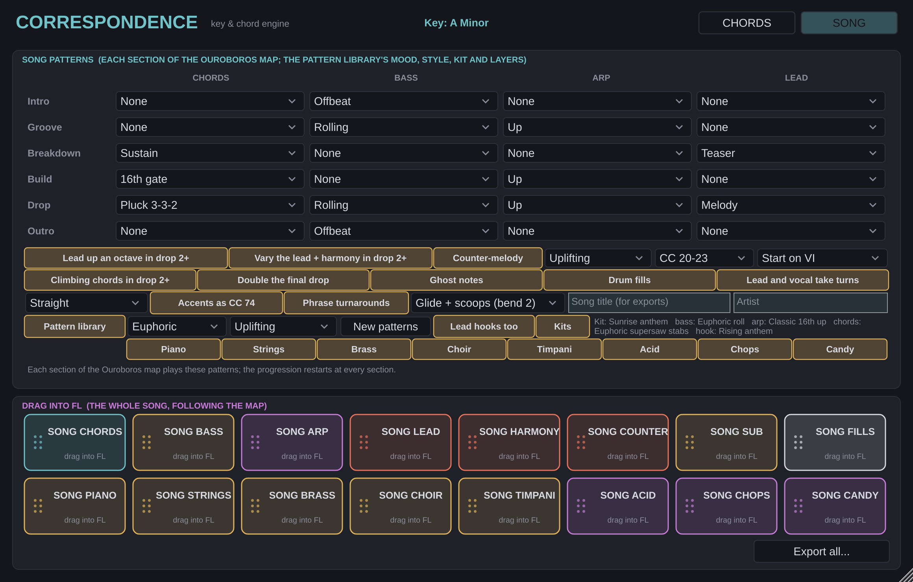
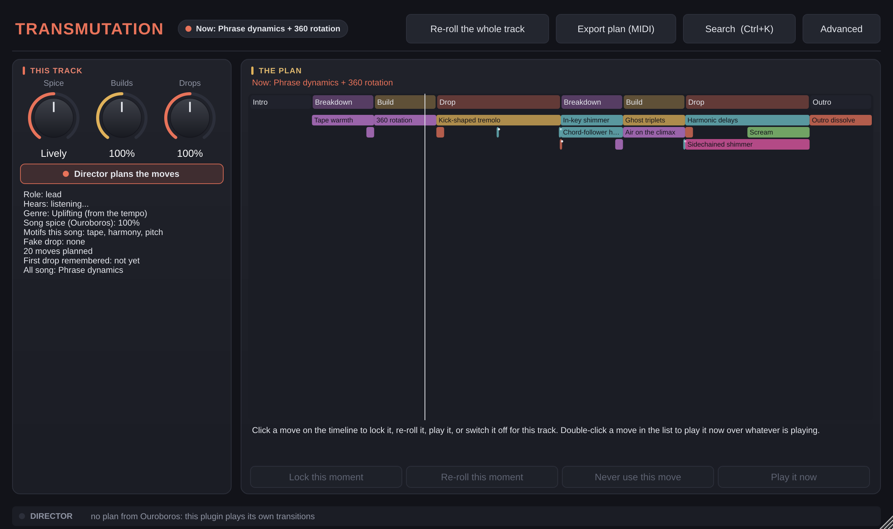
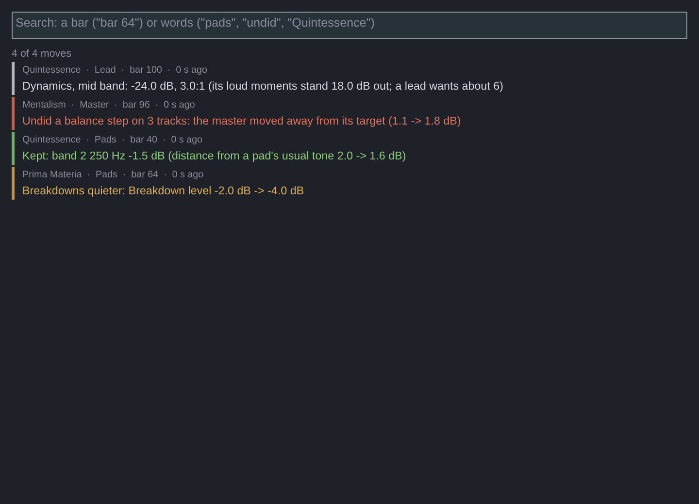
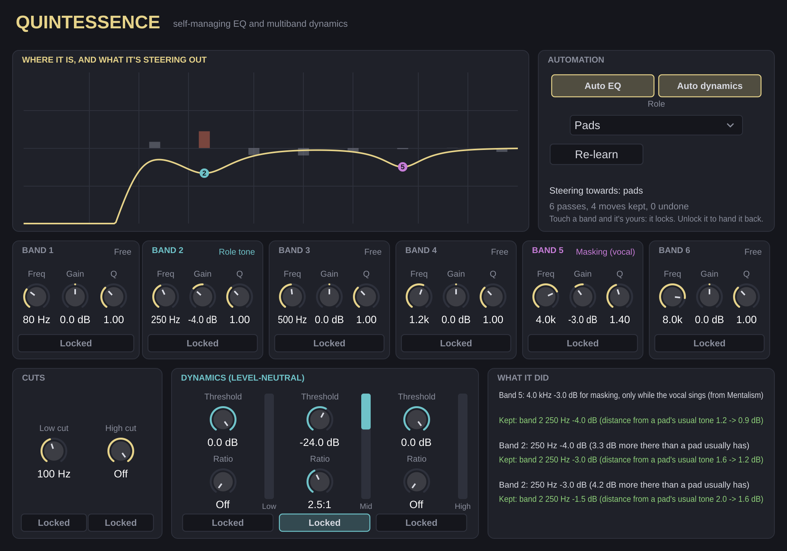

# Antioch Suite

Thirteen VST3 plugins for uplifting trance production in FL Studio. They're built to replace
the setup work you'd otherwise redo in every project. They share one key: set it once
in **Correspondence**, and the others follow it.

| Plugin | What it replaces |
|---|---|
| **Antioch**: harmonic echo, euphoric reverb, throw delay | A delay, a reverb + EQ + sidechain chain, and the send automation for delay throws |
| **Transmutation**: creative moves, directed per track | The build automation you draw for every build (filter, reverb, risers, gates), and the stutters, reverses, freezes, throws and pitch tricks you place by hand |
| **Correspondence**: key and chord engine | Working out progressions, voicings and offbeat basslines in the piano roll by hand |
| **Kybalion**: trance gate + smart ducking | Drawing gate shapes in Gross Beat or Peak Controller, and sidechain/LFO Tool setups |
| **Vibration**: lead polish strip | The EQ → saturation → multiband → widener chain on every lead |
| **Mentalism**: mix assistant | Loudness meters, correlation meters, reference A/B and guesswork about what's wrong |
| **Ouroboros**: arrangement conductor | Automation clips that switch builds, ducking and throws on and off across the song |
| **Lapis**: premaster check and master preview | Checking a premaster's headroom before it goes to mastering, and hearing how it would master (A/B only) |
| **Emerald Tablet**: key detector | Working out the key of a track, loop or acapella by ear |
| **Azoth**: automatic transition FX | Placing impacts, crashes, swells, downlifters and snare rolls at every transition |
| **Prima Materia**: section mixer | Muting, filtering and riding individual tracks section by section with automation |
| **Solve et Coagula**: vocal unmasking | Carving EQ space for the vocal by hand, or a static cut that's there even when nobody sings |
| **Quintessence**: self-managing EQ and multiband dynamics | The channel EQ and multiband compressor you set by ear on every track, then forget to revisit |

## The goal: a label-ready premaster

Every automatic tuning in the suite drives towards one deliverable: a **label-ready, unmastered
track** (a premaster) for the label's mastering engineer.

- **Peaks at or under -6 dBFS** (true peak). The **headroom keeper** (Mentalism on the
  master, autopilot switch *Keep the premaster's headroom*) hears the master's peaks. When they
  go over -6 dBFS, it brings every Quintessence down together: like pulling the master fader,
  the balance and the dynamics stay as they are. With room to spare, it eases them back up.
- **Nothing on the master bus limits, clips or adds loudness.** **Lapis is a reference:** by
  default it passes the audio through untouched and checks the premaster. *Hear the master*
  plays how it would master, for A/B only; Mentalism's checklist and watcher stop a render
  with it left on.
- **The loudness lands where the mix lands** (usually -18 to -14 LUFS integrated). It's
  reported, never chased. Mentalism's default target is *Label-ready premaster*; the master
  targets (club, streaming, your sound) are still there for the preview.
- **Transitions ride levels, never a limiter.** The director holds a build back with a level
  ride, so the drop lands bigger at the same level, and evens out a loudness jump at a
  section change (2 bars, measured by Mentalism).
- **The render plan, the export notes and the checklist** all describe a premaster: 24-bit
  (or 32-bit float) WAV, no dither, the project's sample rate, peaks under -6 dBFS, no master
  limiting, dynamics intact (at least 7 dB from the loudness to the peaks).

## The suite director: one plan for every transition

**Ouroboros** owns one plan for every transition in the song, and every plugin plays its
part in it. Open it with **Director** in Ouroboros' header. When the director is off, or
Ouroboros isn't running, every plugin plays its own transitions as before.

**One hero, quiet supporters, one sentence.**
- Each moment (a section change, a breakdown's hint and peak, a phrase end, a bar you pin)
  gets one **hero**: the plugin that leads it, with its gesture. The others **support**
  quietly or rest.
- Into a drop, the moment can be a **handoff**: Azoth's riser ends into Transmutation's tape stop,
  then Kybalion's gate re-enters on the one. It plays as one sentence, not three noises.
- The players and their gestures:
  - **Transmutation**: repeat, reverse, pitch, filter, space, grain, stereo or tape stop, on
    the track you choose to lead, or on any track.
  - **Kybalion**: gate roll, gap, half-time or stutter.
  - **Antioch**: echo throw, reverb wash or freeze.
  - **Azoth**: impact, riser, swell, snare roll, downlifter or tape stop.
  - **Correspondence**: a pickup fill, a riser arp, a bass drop-out, a chord stab, or the
    hook's first notes alone in the breakdown.
  - **Scenes**: how a drop arrives: a slam, staggered (kick, bass, then the rest), or through
    a filter that opens over a bar.
  - **Silence**, owned by the director: a kick-only bar, or one fake drop per song. A full
    silence before a drop (a half-beat snap or a whole-beat breath) is off by default: switch
    on *Silences before drops* on the Director page (or tell the chat "allow silence before
    drops") for a song that wants it.

**How it plans.**
- **An energy budget per moment**, from the tension curve, the story, your painted intent and
  the bigger / smaller knob. One hero, supporters only within what's left, and no two heroes
  within two bars (the pile-up guard). Most phrase ends are left plain, so the big moments
  stand out.
- **Story presets:** Restrained, Classic, Festival, Experimental. **Genre profiles:** Auto,
  Uplifting, Tech, Psy, Progressive, Orchestral.
- **The song's shape:**
  - a **tension curve** beside the energy curve;
  - a **mood** per section (hope, tension, release, nostalgia and others);
  - a **character** per drop (Statement, Euphoric, Dark, Stripped, Huge), and every plugin
    dresses for it;
  - a **breakdown story**: empty, a hint, the swell, the peak;
  - a **motif** heard small at the first drop and recalled bigger at the last;
  - **fatigue memory**: a gesture waits 32 bars before it's used again, unless it's the motif;
  - a small **surprise budget**.
- **Harmony, key and tempo moves**, written by Correspondence:
  - a borrowed bVI-bVII into a drop, a pedal under the build, a V pickup into the new key,
    or a sus4 resolving on the one;
  - a half-time bass for a breakdown's first bars;
  - an Experimental story can ease the tempo 2% through a breakdown and climb back in the
    build (in every export's tempo track).
- **Arrangement edits**, as moves: the bass drops out for the bar before a drop, the arp rests
  before a breakdown, the pads come in late in a Stripped drop.
- **Placement:**
  - real phrase lengths;
  - gestures that would cover the vocal step back, while Antioch's throw of its last word is
    welcome;
  - a phrase-end move slides into the hook's rest;
  - gestures take more beats at faster tempos.
- **Several candidate plans are scored**, and the best is kept. The score weighs energy fit,
  contrast between drops, variety, clutter, your taste, a reference's style and what was heard.
- **It plans from what it hears:**
  - a **rehearsal pass**: how loud and busy each bar is, from the Quintessences;
  - **Mentalism's measurements**: a drop that didn't land gets more contrast, a sagging drop
    gets a lift, and an unplanned loudness jump is evened out;
  - a **reference track's style**: moves a minute, how often it goes silent, how big its
    changes are.
- **The structure is suggested along with the moves.** A build too short to climb or a
  breakdown too short for its story is lengthened, and a Festival story gets a key change
  into the last drop. Apply it on the *Structure* page.

**The mix around each moment** (Quintessence on every track, Antioch, Lapis untouched):
- **Making room:** two bars ahead, the other tracks make room for the hero (a gentle
  presence dip) and hand it back.
- **The hook first:** on the hook's first bar back, the pads and FX step aside.
- **The low end:** the bass's sub clears for the impact's beat.
- **Holding the build back:** the build is held back a little with a level ride, then
  released on the one.
- **Space and width:** the space goes dry into the drop, its tails are cut at the drop, and it
  opens wide on the hit. Every track narrows into the drop and widens on the one (not the
  kick or bass, and mono-safe).
- **Silence:** every track falls silent in the director's silences, except the kick in a
  kick-only bar.

**Steering:**
- **Paint intent:** right-click a section on the timeline for *Calmer*, *More*, *No moves*,
  its own spice or its mood. Right-click a lane to pin a hero to a bar, or to block moves for
  8 bars.
- **Per moment:** lock, re-roll, freeze, undo, *Edit…* (who leads, what each plugin plays,
  the silence, which track leads), rate up or down, *Like this* (teach it: the moment becomes
  one of your gestures for that kind of moment), and save it as a template or apply one.
- **Plan history:** every plan you've heard is kept, and you can step back to any of them.
- **Director chat:** "make the second drop hit harder", "less glitch in the breakdown",
  "darker", "more silence before the final drop", "simpler", "wider", "undo", "reset".
- **Profiles:** save your story, genre, taste, requests and taught gestures; export one to
  share, or import a friend's.

**Trust:**
- **What it plans:** the plan in words (*Summary*), the *Legend* of every gesture, *What
  changed* since the last plan, and a **?** on the timeline at low-confidence moments.
- **Before it plays:** the *Lint* page lists collisions, two heroes at once, a gesture under a
  sung word, a key clash, a drop with no contrast, or a long section with no moves.
- **The why of any second:** click anywhere on the timeline to see which plugins act there
  and why (*Explain*). The inspector gives the why of each moment.
- **Hearing it:**
  - the *Render list* gives just the transitions, 2 bars either side, as bar ranges and FL
    markers;
  - *Hear the previous plan* is the before/after A/B;
  - **Safe mode** keeps only filters, levels and space.
- **After a play-through:** the *Fidelity* page shows what every plugin actually played at
  each moment, and anything it played outside the plan.
- **Version lock:** keeps this exact plan, so a render can be redone later.
- **The ticker:** Ouroboros shows what's next ("Next: bar 89 (in 6 beats), into the drop:
  Azoth impact"). Every plugin's window has a director strip: "bar 89: you lead, gate
  roll", or what it does around the moment.

## How much runs on its own

With the full suite loaded, here is everything that happens without automation clips:

1. **Emerald Tablet** hears the key and hands it to **Correspondence**, which shares it
   with every plugin.
2. **Ouroboros** listens to one play-through and proposes the song's sections (or drafts a
   map from a length and a few choices with **Arrange**), then tells the suite where it is.
3. **Transmutation** plans creative moves on every track for each build, drop and breakdown, **Kybalion** stops ducking in breakdowns,
   and **Antioch** throws at section ends.
4. **Section scenes** move each plugin's key controls per section: more reverb and shimmer
   in breakdowns, more Euphoria and width in drops, and so on.
5. **Azoth** plays the transition FX on cue: impact and crash into drops, a swell before
   them, a downlifter into breakdowns, and a snare roll through builds.
6. **Prima Materia** on individual tracks mutes, filters and rides them per section, so
   one looped groove arranges itself.
7. **Correspondence** exports full-song chord, bass, arp and lead clips that follow the map,
   including a generated melody (Melodia).
8. **Mentalism** measures against its target and shares it, and **Lapis** sets the master
   gain to hit it. Mentalism's **arrangement coach** checks the energy arc section by
   section, and its **Fix** buttons adjust the other plugins in one click.
9. **Every drop after the first goes bigger**: more echo and Euphoria, louder impacts,
   longer swells, the lead up an octave and embellished with a harmony line, and an
   optional **key change** for the last drop that the whole suite follows.
10. **Solve et Coagula** makes room for the vocal in the music, only where and when it sings.
11. **Set-up:** Prima Materia and Kybalion set themselves up from the track names, every
    Kybalion can duck to the real kick with no routing (**Suite kick**), **Rough mix**
    balances the tracks, and Ouroboros' **Suite** overview says what's still missing.
12. **Quintessence** on any track EQs and compresses it towards what that part usually
    sounds like, checking every move and undoing the ones that don't help.
13. **Snapshots** save and compare whole versions of the song across every plugin, and
    **Export all** writes the song's MIDI in one go.
14. **The autopilot** handles harshness, instability and crowding while you choose sounds
    and effects (see below).

What's left to you is writing and arranging the music, plus choosing taste settings.

**Where to put everything:** [Organising the suite in FL Studio](docs/Organising-the-suite.md)
has the track names, the plugin order on each track, the routing, and how to save it as
your FL template. **What it did:** Ouroboros' *What changed?* lists every automatic move in
the suite, with the track, the bar, the reason, and whether it was kept or undone.

### The autopilot: harshness, stability, crowding

The tune should come out of the sounds and effects you pick, so the suite handles the rest
by itself, moment to moment. Ouroboros' menu has *Autopilot*: one switch for each of the four groups (saved
with the project), and a count of everything done. Every move is also in *What changed?*.

- **Harshness.** Mentalism hears a harsh moment on the master (2-8 kHz jumping well over its
  own average) and names the one or two tracks causing it; their Quintessences dip that band
  by up to 4 dB while it lasts. Leads, pads and FX get a spike tamer on bright bands, Vibration
  eases its drive by up to 6 dB as the lead climbs, Antioch darkens its reverb and echo tails
  during harsh moments, and a resonance that several tracks share is cut a little on each
  instead of a lot on one.
- **Stability.** Antioch catches runaway echo or shimmer feedback (tails that grow with no
  input) and Transmutation catches an effect running away on its own, and each backs off.
  Prima Materia removes DC and sub-18 Hz rumble, holds a one-off peak far over the part's
  normal level, rides slow level wobble on bass and pads (2 dB at most; deliberate level
  changes are left alone) and smooths section-change jumps. Quintessence narrows a track whose
  stereo sides start cancelling. Correspondence moves bass notes under C1 up an octave.
- **Arrangement.** In the song draft, when too many parts would play at once the layers that
  matter least in that section sit it out (a breakdown keeps its piano, strings and choir; a
  build its timpani and strings; a drop its strings, acid and brass), and chops and candy step
  back while the hook is moving so they answer it in its gaps.

- **Mixing.** The Quintessences hear each other: a track dips (up to 3 dB) where a more
  important part plays in the same band at the same moment (vocal, then lead, then kick and
  bass, then pads, then hats and FX). Pads and FX dip only at the lead's actual note and its
  octave (from Vibration), so the lead cuts through without the pad going thin; a lead or vocal
  still masked lifts its presence 1.5 dB. With a kick or bass playing, everything else gives up
  its energy under 70 Hz. A pad, lead, hat or FX attack landing on a kick hit is softened. The
  stereo part under 120 Hz is removed on every track. Bass notes that boom or vanish are evened
  note by note, and a bare sub gets harmonics around 350 Hz so it's heard on phones. In pads,
  leads and FX a band that rings out past its usual level is soothed while it rings, and a
  pitched FX holding a note outside the key is notched there. Drum hits far louder than the
  ones around them are evened, and tails and hiss under -60 dBFS are pulled down. Grooves,
  intros and outros get their own EQ correction on top of the drop's (breakdowns already had
  theirs). A track named reverb, delay, echo, return, send or space, or with Antioch on it, gets
  a 180 Hz low cut and a 12 kHz high cut. Antioch's space always pumps a little with the kick and
  steps back while the vocal sings as well as the lead.

- **More mixing helpers.** The bass dips 6 dB at the kick's own note for the 60 ms after each
  hit (the kick's pitch comes from Kybalion), cleaner than ducking the whole bass. The kick's
  body (under 150 Hz) is re-pitched down to the nearest note of the song's key, the root or
  fifth by preference and 2 semitones at most, leaving its click alone. With two or more pads
  (or leads) playing, each sits a little to one side, with the low end kept centred. Antioch's
  tail dips at the lead's note and its octave while the lead plays. Its pre-delay snaps to the
  nearest 1/128-1/16 note, and its decay is rounded down to whole beats. A track named drums,
  perc or beats gets bus glue.
- **More automatic fixes.** Antioch holds a track at its input's loudness however much space
  it adds (the last 3 s of input carry the tails after a phrase), and narrows its own reverb
  and echo wherever they would cancel in mono. The bass's sub clears for the 6 ms before each
  kick as well as after it. On the vocal, plosive pops are cut for a moment and breaths between
  phrases come down 6 dB. A clip that starts abruptly out of silence gets a 1 ms fade-in (not
  on kicks or percussion, whose attack is meant). A track leaning to one side (and not a wide
  stereo sound) is re-centred, 3 dB at most. A pitched FX holding a note outside the key is
  re-pitched to the nearest key note, a semitone at most. *Hear without the automation* plays
  each track at the loudness it had with Quintessence, so the comparison is about the sound.
- **Round B.** A steady 50 or 60 Hz hum (heard in a track's quiet moments) is notched with
  three of its harmonics. A clip that stops dead gets a 1 ms tail instead of a step. Two
  tracks of the same role hitting together a few ms apart (two kick layers, a layered lead)
  are lined up: the earlier one waits for the later, up to 12 ms, with no added latency.
  Antioch de-esses what it sends into its reverb and echo (the track keeps its "s"). Past the
  map's last bar, Antioch's and Transmutation's tails fade out over 2 bars, so a render ends
  clean. Vibration's drive is fed a steady level (around -12 dBFS) whatever arrives, and
  the level is given back after, so turning the synth up doesn't make the lead dirtier (the
  drive already runs 2x oversampled). In the song exports, a note ringing on into a chord it
  clashes with ends at the change.
- **Mixing suggestions** (in Mentalism's suggestions; they change nothing): a kick, percussion
  or vocal arriving already flattened (back off the compressor before Quintessence); more than
  two tracks with their own Antioch (move them to returns); a level jump at a section change
  the energy curve doesn't ask for; the drops building up 250-500 Hz, with the tracks adding
  most; and, after every 45 minutes of listening, a reminder to rest your ears.

## How the suite glues itself together

- **One move at a time (the conductor).** Every plugin that moves by itself (Quintessence,
  Antioch's space level, Vibration's drive, Lapis' tilt, Mentalism's balance loop) asks for
  the turn first and gives it back once its move is checked. The turn goes by need: of the
  plugins turned away, the one furthest from where it should be goes next (a Quintessence
  also counts how much of the master's current problem band is its own energy). While a move holds the turn, Mentalism measures the master's tone before it and
  3 s into it. If the move took the master more than 0.5 dB further from its target, the
  owner undoes it, even if it helped its own track. So two plugins never chase each other,
  and nothing improves one track at the mix's expense.
- **Tone budget.** The vocal owns 2 kHz (where its words are) and the lead owns 4 kHz over
  the pads. A pad, lead or FX track that's strong there gets a gentle 1.5 dB dip from its
  Quintessence that opens only while the owner plays: room made before there's a clash.
- **Phrase riding.** In a drop, groove or breakdown of two or more 8-bar phrases, Prima
  Materia lifts each phrase a little over the one before (1 dB from first to last, centred
  on the section's level), the way a hand on the fader carries a section forward.
- **Groove lock.** Correspondence's groove (its swing) sets the swing of Kybalion's gate,
  the exported clips, and now Azoth's snare rolls, so the whole track swings the same way.
- **Glue room.** A new Antioch on the music bus becomes one short shared room (0.9 s, no
  echo or throws, about 18 dB under the music, level set by itself). The tracks' own
  Antiochs give each part its depth; this puts them in one space.
- **Transitions.** Through a build, Quintessence tightens the bus glue (up to 3 dB) and
  widens the image (up to 25%, never the kick, bass or vocal); the drop's first beat lets
  both go. Builds aren't measured for automatic moves, since the change there is on purpose.
- **Section loudness.** When the auto-coach isn't running its own passes, the problem
  watcher applies the coach's level fixes by itself (a breakdown too loud against the drop,
  a build that doesn't rise, a later drop no bigger), one section at a time. Each section is
  heard again before it's judged again. Structural changes (extending a section) are
  offered, not made. Lapis keeps the drop at its loudness target, so the arc sits on that.

### Plugins that listen to each other, one decision everywhere, the whole mix watched

- **The vocal leads the arrangement.** While Solve et Coagula hears the vocal, the busy parts
  (a track named *arp* or *pluck*) step back further than the pads (about 3.75 dB against
  1.5 dB) and come back when the phrase ends.
- **The lead's phrases are left alone.** While Vibration says the lead is playing, the automatic
  throws on other tracks' Antiochs wait (manual throws still fire).
- **One kick drives the bus too.** On the music bus, Quintessence's glue adds up to 1.5 dB of
  reduction just after each hit of the suite kick (Kybalion's shared pattern), with no
  routing. Antioch's reverb pump and Azoth's impacts already follow the same kick.
- **Room at the chord's root.** On pads and leads, Quintessence leaves a 2 dB notch at the root
  of the chord playing (from Correspondence), down where the bass plays it.
- **Room for the riser.** While Azoth's riser or swell plays, pads and leads give way 3 dB around
  4 kHz, so it cuts through without being turned up.
- **One energy dial.** Draw a section's energy in Ouroboros and the plugins follow it.
  Kybalion's gate cuts deeper or softer, Vibration's Euphoria rises or falls, Quintessence's
  glue tightens or loosens, Antioch's space closes or opens, and Prima Materia's level moves.
- **Hear without the automation.** *Start from a template... > Hear without the automation*
  takes every automatic move out of the sound at once: Quintessence, Antioch's space trim,
  Vibration's drive trim, Lapis' tilt and Prima Materia's phrase ride. Choose it again to put
  them back. Nothing is forgotten, and it lapses after 10 minutes.
- **Moods.** *Mood: darker/brighter* moves the master's tilt (Lapis) by a dB, *wider* widens
  the pads, leads and FX 15% (Quintessence), and *more pump* deepens Kybalion's ducking 10%.
  Each can be undone like any fix.
- **Releases follow the tempo.** Quintessence's multiband releases scale with the tempo, as its
  glue does.
- **Section by section.** Mentalism keeps each kind of section's low end against the target. If
  an intro, groove, breakdown or outro runs more than 4 dB heavier below 125 Hz than the
  drops, the watcher brings the bass down 2 dB there, by itself.
- **Masking where it happens.** Carves made for clashes heard in the drops are set *not in
  breakdowns*, where the music thins out and there's nothing to clash with.
- **Headroom.** If Lapis is holding back more than 6 dB, or the master hits Lapis over full
  scale, the watcher gain-stages every track down together, so the limiter needn't clamp.
- **Stereo field.** *Start from a template... > Stereo field* shows how wide each track sits
  (from its Quintessence), widest first.

### Writing and mixing feed each other

- **Thin sections get a layer.** Mentalism hears each kind of section's mids against the
  target. A groove or build running 4 dB thinner than the drops, or drops 3 dB under the
  target, is listed under *Problems*. Correspondence's Export all then writes **SONG LAYER**,
  a sustained chord pad (open voicing, around middle C) for just those sections.
- **The mix follows the writing.** Each Export all compares every part with the last export.
  Parts whose notes changed (a new lead, new chords) tell the Quintessences and Prima Materias
  on those roles to measure afresh; the rest keep what they've learned.
- **Writing around the vocal.** Solve et Coagula shares what the vocal sang. In the exported
  lead, arp, counter-melody and harmony, a note that rubs against a note the vocal holds (a
  semitone, a major seventh or a tritone away, held a beat or longer) steps to the nearest
  note in key that doesn't.
- **Finish everything.** *Start from a template... > Finish everything* starts the learning
  pass, Mentalism's Mix it and Correspondence's Export all together, and shows the render
  plan. Play the song once from the top; every move shows in *What changed?*.

## Correspondence: key and chord engine


Two pages (top right): **Chords** has the key, the progression, voicing, rhythm and the loop
clips; **Song** has the section-by-section patterns, the pattern library (mood, style, kit,
layers, the families in use) and every song clip to drag into FL, each tile full size. The
window can be dragged bigger; its size and page are saved with the project.



- **Key and scale** (minor, major, harmonic minor, Dorian, Phrygian, Mixolydian) are
  broadcast to the other plugins. Turn **Broadcast key** off to stop that.
- **Progression:** 2–8 chords, each set by scale degree (I–VII) and type (Auto, Major,
  Minor, Sus2, Sus4, 7th, Add9, Power). Auto stays inside the scale. Ten presets cover the
  classic trance moves (i–VI–III–VII, VI–VII–i, i–iv–VI–V, …).
- **Voicing:** Close, Open (drop-2, pad-like) or Wide (root doubled below). Voice leading
  keeps each chord close to the previous one, so pads move smoothly.
- **Rhythm:** chords can be sustained, offbeat stabs, a 3-3-2 pluck or a 16th gate. Bass
  can be offbeat, rolling, galloping, sustained or walking. Arps go up, down, up-down or bounce.
- **Drag into FL:** drag the **Chords**, **Bass** or **Arp** tile straight onto FL's
  playlist or into a piano roll, and it lands as a MIDI clip. **Save MIDI…** writes all
  three to a folder instead.
- **Audition:** click a chord, or press **Play**, to hear the progression through a
  simple preview tone. The audio of the channel it sits on passes through unchanged.

Put it on any mixer insert, the master for example. It doesn't change the audio passing
through it.

## Antioch: space bundle


There's one master strip (Dry, Echo, Reverb, Throw and Output levels, plus the key) and
three tabs:

- **Echo:** four tempo-synced taps. Each repeat goes through a pitch shifter (−24…+24
  semitones) and a resonator tuned to a harmonic of the key, so the echoes climb into
  chords and ring in key. **→ Reverb** sends the echoes into the reverb.
- **Reverb:** an 8-line reverb with decay up to 20 s, pre-delay, modulation, width and
  low/high cut. **Shimmer** feeds back a pitch-shifted copy of the tail (+5th, octave,
  octave+5th, 2 octaves or −octave). **Duck** pushes the reverb down while the dry signal
  plays, so it blooms in the gaps without washing out the lead. **Freeze into breakdowns**
  (with Ouroboros): as each breakdown starts, the last half second of the reverb is held as
  an endless wash under it, fading out over 1, 2 or 4 bars (**Freeze level** sets how loud).
  **Tension** (default 30%, with Correspondence running) widens the reverb on the chords
  that pull away from home (anything but i and its relative major), up to half again as
  wide at 100%, and brings it back on the home chord, so the space breathes with the
  harmony.
  **Pump to kick** (off by default) ducks the reverb tail on every kick of the pattern a
  Kybalion shares (Share kick), so the space pumps with the groove without a ducker.
- **Throw:** a dub-style delay that only takes in audio while the **THROW** pad is held
  (or latched, or automated). The tail keeps ringing after you let go. **Auto Throw**
  catches the last 1/16th to 1 bar of every 2, 4, 8 or 16 bars while FL is playing, so
  phrase-end throws happen without any automation. It has ping-pong, drive, filters,
  ducking and a send to the reverb. **At vocal phrase ends** throws the last beat (or
  the length you choose) of every sung phrase: put Antioch on the vocal and play the song once
  with Solve et Coagula hearing the vocal, and its last words echo out wherever a phrase ends.

**Auto space level** (switched on by itself on a lead, vocal or pad track): every 4 s of
the part playing outside breakdowns, Antioch measures how far its echo and reverb sit under
the dry part and steers the *Space trim* towards what the role usually has: a lead's tail
about 12 dB under it, a vocal's 14, a pad's 10. One step of up to 1.5 dB at a time, kept if
the tail got closer, undone if not, and logged in *What changed?*. Breakdowns are left to the
section scenes, which open the space on purpose.


## Transmutation: creative moves, directed for each track



Put one Transmutation on every track you want to move: the kick, the bass, the pads, the
lead, the vocal, the FX. It works out the track's role (from the track's name, Prima
Materia, or the Role menu) and listens to what the track is: pitched or not, held notes or
plucks, busy or sparse. A **director** then plans creative moves across the whole song
from the Ouroboros map, the tempo, the key and the chords. You don't draw any automation.

Each role builds its own way, so a build sounds like the arrangement doing it, not a filter
on top: the bass steps aside, the pads open and widen, the lead's echoes grow, the drums
roll, and the FX rise from their own audio. That is the job Cause & Effect used to do on the
bus; Transmutation replaces it.

**The 118 moves**, in ten groups (the full list is in the plugin, each with a description):

- **Builds, drops and breakdowns:** role-aware builds, layered emptying, a Shepard rise
  from the track itself, a staggered tape-stop, the drop's first 16th, a stereo bloom, the
  inhale before the drop, a rewind, the build squeeze, the fake drop, the snare-roll sync,
  a riser from the chord, the drop echo, the breakdown swallow, the final-drop overdrive and
  the outro dissolve.
- **Rhythm and glitch:**
  - beat-repeat rolls, reversed last beats and polyrhythmic gates
  - a kick-aware slicer, the halftime bar, swing drift, the hook stutter and buffer shuffles
  - off-beat crush, ghost triplets, glitch dropouts, kick-shaped tremolo and an accelerating gate
- **Pitch and harmony:**
  - climbing echoes, harmonic delays, octave bloom, a chord resonator and key-locked frequency shifts
  - a chord-following harmonizer, the last-note drop, the glide to the drop and the detune bloom
  - the key-change sweep, a root drone, the arpeggiated echo, in-key shimmer and the bass slide
- **Space and texture:**
  - hook memories, underwater, freeze to pad, reverse-delay lead-ins, grain clouds and vowel morphs
  - room by energy, Doppler fly-bys, 360 rotation, tape warmth, distance and the chord-change smear
  - an ambient bed, the room swap, echo dub-outs and the telephone moment
  - breathing width, space that follows the vocal, air on the climax and the cassette fade
- **Expression:**
  - living long notes, a key-tracked filter, the scream, and pads that pulse with the roll
  - phrase dynamics, downbeat accents, a humanised filter, energy brightness and velocity colour
  - call-and-response pan, the chord pluck and chord-weighted width
- **No limits:**
  - reverse song memory, a crowd of copies, morphing into the lead and vocal-shaped pads (both opt-in)
  - rhythm borrowing, breathing silence, granular stretch, the overtone sweep and spectral blur
  - the reverb stutter, sidechained shimmer, the tape loop, the euphoria cascade, the inverted drop
    and self-remix fills
- **The director:** signature moves, the story arc, call and response, motifs, rest, vocal
  priority, the plan preview and audition, and genre profiles.
- **Transitions:** continuity, the drop countdown, snap to silence, the echo bridge and the
  sweep handoff.
- **Per role:**
  - kick: boom and punch
  - bass: flips and growl
  - hats: open, roll and choke
  - pads: swell, drift and gate
  - plucks: stepped filter and caught echo
  - vocals: throws and freezes
  - FX: swells and fly-bys
- **Physics:** gravity, elastic time, weather, the spectral chase, echoes in key,
  contagion, song breathing and the mirror drop.

**How the director chooses.**

- **Where:** it picks per track and per moment: a build, its last bar, the drop's first bar,
  a breakdown's start and peak, phrase ends, the outro, the key change. Big moments get more
  moves; grooves get fewer.
- **What suits the track:** only moves that suit the role and what it hears. Harmony and
  pitch moves need a pitched part; freezes and blooms need held notes; slicers need a busy part.
- **Across the song:**
  - **Story arc:** a restrained first drop, more in the second, everything in the final.
  - **Motifs:** three kinds of move that come back.
  - **Rest:** a plain moment after a busy one.
  - **Vocal priority:** small moves while the vocal sings.
- **Across the tracks:**
  - Tracks don't all do the same thing at once.
  - **Call and response:** the pads answer the lead's gesture a bar later.
  - **Contagion:** the lead's stutter spreads to the next track, and the next, into the drop.
  - **Drop countdown:** each role takes one of the last 4 beats.
  - **Sweep handoff:** the build's sweep travels from track to track.
  - **Fake drop:** one song-wide choice every track agrees on.
- **Genre:** Auto (from the tempo), Uplifting, Tech, Psy, Progressive or Orchestral. Each
  favours its own moves.
- **Signature moves:** moves you lock or set to Always go in your style log, and come up more
  in later songs.

**Your control.**

- **Spice** per track, from Subtle to Wild, plus the song's spice in Ouroboros (and
  **Re-roll the song** there).
- **Builds** and **Drops**: how hard each works. Mentalism's *build rise* and *build impact*
  fixes turn these up.
- **Auto / Always / Never** for each of the 118 moves.
- **The plan** on a timeline: click a move to **lock** that moment, **re-roll** it, switch the
  move off, or **play it now**. Double-click any move in the list to hear it over what's
  playing.
- **Re-roll the whole track** for new dice on just this track.

Ouroboros' menu has **Transmutation: every track's creative moves** with every track's plan
on one timeline. **Export every track's moves** writes them as one MIDI file. Each track's
**Export plan (MIDI)** does the same for that track. Each file has:

- a MIDI track per FL track
- a note per move, whose note number is the move's number
- a marker naming the move

You can then see the moves, edit them, or turn them into automation in FL. Plans depend only on
the map and your choices, so a render plays what you heard.

**It follows the real phrases.** Correspondence shares where its hook rests. A phrase-end move
goes into the hook's rest nearest the phrase's end (within a bar), and steps off the vocal's
notes (heard by Solve et Coagula) by up to two beats. Where it can't step off, it stays smaller.

**Level-matched:** like the rest of the suite's effects, every move changes the sound, never
the level. The output is held at the input's loudness (a 300 ms RMS; layers added to a silent
track come through at up to -24 dBFS).

**Autopilot:** the Autopilot page has a switch for *Creative moves at transitions* and
*Catch a runaway effect*. If an echo or shimmer runs away on its own, its tails are cleared at
once. Past the song's last bar, the echoes, reverb and layers fade out over 2 bars.

**Moving from Cause & Effect:** remove it from the music bus and put Transmutation on the
tracks instead (at least the pads, the lead and the FX). Builds then happen per track.

## Kybalion: trance bus (Rhythm + Polarity)


**Rhythm** is a 16-step trance gate.

- Draw step levels by clicking or dragging on the grid (right-drag erases), pick from 9
  patterns (straight 16ths, trance classic, 3-3-2, offbeat, gallop, stutter, accents,
  half-time, ramp up), or hit **Randomise**.
- Step size can be 1/8, 1/16 or 1/32. **Length**, **Attack** and **Release** shape each
  step. **Depth** sets how far closed steps drop.
- **Swing** pushes every second step later.
- **Stereo offset** shifts the right channel's pattern by 1–8 steps, for gates that
  bounce left and right.
- **Filter** makes closed steps darker as well as quieter, with resonance.
- **Fills** (with Ouroboros): the last bar before each drop (and, with *Both*, each
  breakdown) plays a fill instead of the pattern: **Stutter** (1/32 chops), **Half-time**,
  **Gap** (silence on the last beat), **Roll** (1/8 → 1/16 → 1/32), or **Auto**, which
  alternates roll and gap into drops and uses half-time into breakdowns.
- **Your own patterns:** draw a pattern and choose *Save this pattern…* in the pattern
  list. It's saved as a file (in *Antioch Suite/Gate patterns*) and listed as *"Mine: …"*
  in every project.
- **From the song's chords / arp** (in the pattern list): the gate takes the rhythm of the
  song's own chord part or arp, which Correspondence's pattern library shares. Accents open
  fully, hits at 80%, ghosts at 40%, and held notes keep the step open.
- **Suite groove:** when Correspondence's *Groove* is a shuffle, the gate swings with it
  (unless its own Swing is set higher), so gated pads sit with the exported MIDI.
- **Chord changes** (with Correspondence running): *Accent* opens the gate fully on the
  first step of every chord change and lifts it a touch, so pads pulse with the harmony;
  *Restart* starts the pattern again at each change (it matters when chords are shorter
  than the pattern). Changes are counted from each section's start, as Correspondence
  writes them.
- **Dynamic gate** (off by default): the gate's depth follows the song: in drops it grows
  from 60% to full over the drop; elsewhere it follows the section's energy, so a quiet
  breakdown gates gently and a hot groove hard.
- **Pan steps** (off by default): each step moves in the stereo field: *Ping-pong*
  (left, right), *Left-centre-right* or *Bounce* (left, centre, right, centre).
- **Your patterns rise to the top:** a song played into its final drop logs the gate
  pattern you kept (and the kind of track, from its name). The pattern list starts with your
  three most used, and once a pattern has been kept in two songs, a new Kybalion starts on it,
  and on your favourite for pads, plucks, leads... as soon as the track's name says what it
  is (never over a pattern you chose).


**Polarity** is ducking with no sidechain routing.

- In **Tempo** mode it ducks on the beat grid (every 1/2, 1/4 or 1/8). A negative
  **Nudge** ducks slightly before the beat, which works like lookahead with no added
  latency.
- In **Sidechain** mode it follows a kick you route into the plugin's sidechain input,
  with a threshold.
- Presets for each element: Bass (tight), Pads (deep), Leads (gentle), Classic pump,
  Reverb & delays, and Lows only.
- In **Suite kick** mode it ducks to the real kick with no routing at all: turn on
  **Share kick** in a Kybalion on the kick track, and it learns where the kick hits in the
  bar (separately for each section type) and shares that pattern. Every Kybalion set to
  Suite kick then ducks on it, offbeat kicks, gaps and all. Until a kick is shared, it
  ducks on the beat grid. A Kybalion on a track named "Kick" turns Share kick on by
  itself.
- **Fit to kick:** with a kick on the sidechain (or shared), Kybalion measures how long
  it rings and the pitch of its body. The button sets Hold and Release to match, and the
  status line shows the kick's note against the song's root (for example *"55.1 Hz (A1 +4
  ct): in tune with the root"*, or how many semitones to retune it).
- **Phase check:** while a kick plays on the sidechain (or shared), Kybalion compares this
  track's low end (below 120 Hz) with the kick's. If they cancel, the status line says
  *"low end OUT OF PHASE with the kick"*: turn on **Flip polarity** (next to Breakdown),
  which inverts this track.
- **Share kick** also shares the kick's body pitch (measured on the kick track), for Azoth's
  impact.
- **Split** ducks only below a chosen frequency, using a Linkwitz-Riley crossover, so the
  bass pumps and the top stays put.
- **BREAKDOWN** switches ducking off. Automate it for breakdowns where the kick drops
  out.
- The curve display shows the gain shape over two beats, with a live position marker and
  a gain-reduction meter.

Put it on any insert. A typical setup: Rhythm on a pad or pluck bus, and Polarity
(Tempo, *Bass (tight)*) on the bass.

**Kick and bass.** With the suite kick shared, Kybalion reads the kick's body pitch and
compares it with the key. In *What changed?* you get a line like "Kick body 52 Hz (G#1): tune
the kick +1 semitone to the root (A)". **Duck focus** can duck only *around the kick's note*:
the kick's note comes down and the rest of the bass keeps sustaining through the kick. On
*Auto* (set by itself on a bass track) it measures how much of the bass's low end sits on
the kick's note. If less than half does, it ducks around the note; otherwise it ducks the
whole sound. Each change is logged.

## Vibration: lead polish strip


Put it on a supersaw lead, pluck, pad or arp. Turn up **EUPHORIA**: one knob adds air,
presence, saturation, multiband glue and width, and cuts mud, all at once. A line under
the knob shows exactly what it's applying. Start from a preset (Supersaw lead, Pluck,
Pad, Vocal chop, Arp, Clean), then fine-tune:

- **Tone:** low cut, mud (320 Hz), presence (3.2 kHz) and air (10 kHz shelf).
- **Saturation:** drive and mix. It runs at 2x oversampling so heavy drive stays clean
  rather than aliasing.
- **Multiband:** OTT-style, splitting into 3 bands at 250 Hz and 3 kHz. Loud parts are
  pushed down and quiet parts lifted, with **Depth** as the mix and **Time** scaling the
  speed.
- **Width:** sides up to 200%, with everything below **Mono below** kept mono so the
  lead's low end doesn't smear.
- **Auto gain:** on by default. It matches the output level to the input, so you judge
  the tone rather than the volume.
- The spectrum shows input (grey) against output (gold).
- **Lead fingerprint…** keeps your lead sound across projects. Play the lead for about 5
  seconds and choose *Save this lead's fingerprint*: it stores the character (Euphoria,
  low cut, drive, saturation, multiband, width) and the tone of the processed lead (its
  octave-band shape from 125 Hz up). In another song, on another synth, choose *Match:
  <name>*: the character comes back, and Mud, Presence and Air move 70% of the way towards
  the stored tone. Play it again and match once more to refine. Fingerprints live in
  *Antioch Suite/Lead fingerprints*.
- **Tension width** (default 30%, with Correspondence running): the lead widens on the
  chords that pull away from home (up to 50% wider at 100%) and narrows back on the home
  chord.
- **Pitch bright** (off by default): Vibration tracks the lead's pitch; notes above its
  usual pitch get more air and presence (up to +4 and +2 dB) and notes below get less, so
  the top of a melody sparkles and low notes stay warm.
- **Auto drive** (saturation by ear; switched on by itself on a lead or pad track): every
  4 s it measures how much of the part sits above 2 kHz against its body below 1 kHz. A
  lead's harmonics usually sit about 12 dB under the body. Too clean (it disappears on a
  phone): 3 dB more drive. Harsh: 3 dB less. Each step is kept only if it got closer.

## Mentalism: mix assistant


Put it last on the master. It only measures and leaves the audio bit-identical. Play the
track (or its loudest section) and read the numbers:

- **Loudness:** momentary, short-term and gated integrated LUFS (ITU-R BS.1770 / EBU
  R128), plus true peak with 4x oversampling. A gauge shows integrated loudness against
  the target: Club master −8 LUFS, Loud club −6, Streaming −14, or **My sound**. A reference
  never sets the loudness: it's normalized to the project's target.
- **Stereo:** full-band correlation, correlation below 120 Hz (is the low end mono?),
  and how much level the mix loses when summed to mono.
- **Tonal balance:** 10 octave bands compared with a target. Bars show the whole song,
  the line shows the last 3 seconds, and the shaded zone is ±3 dB. Only the shape is
  compared, not the overall level. The built-in curves for uplifting and progressive /
  tech trance are rough guides. **Load reference…** (WAV/AIFF/FLAC/Ogg/MP3) analyses a
  track you like and uses it as the target instead. The reference is saved with your
  project.
- **Suggestions:** plain-language advice ordered by importance. For example: *"Low-mids
  (250 Hz) is 5.0 dB above the target: classic mud: cut 200-400 Hz on pads, bass and
  reverbs."*

**Masking** (third tab). Each Prima Materia measures its track's spectrum in the drops
and shares it. Mentalism lists the pairs of tracks fighting for the same band (from
250 Hz to 8 kHz: a band that's prominent in both, at similar levels), worst first, e.g.
*"Pad and Lead clash at 2 kHz in the drops: carve Pad"*. **Fix** carves a 3 dB dip at that
band into the less important track (vocal keeps over lead, lead over kick and bass, then
pads, hats, FX); press again to go deeper (up to 9 dB). Prima Materia's status line shows
the carve, and History undoes it.

Mentalism also keeps an eye on masking while you work: the clashes are checked every 30
seconds of playback, and one that's still there after three checks in a row (over a minute)
appears among the Suggestions. It never carves anything by itself: the Fix stays your call.

**Match reference** (Tonal Balance tab, with a reference loaded and at least 10 s of the
song measured) compares your mix's long-term balance with the reference and moves Lapis'
new **Low tone** (100 Hz shelf) and **High tone** (8 kHz shelf) half-way towards it, at
most 4 dB each. It leaves the loudness target alone. It's deliberately
gentle, so press it again if you want to go further, and it's in History to undo.

**Reset** starts a new measurement, for example after changing the mix.

**Export checklist** (Suggestions panel) is the last look before rendering: the song has
been measured, loudness is within 1 LU of the target, true peak is under the ceiling, no
samples clipped, the low end holds up in mono, the mix survives a mono sum, no section is
silent by mistake, the coach is happy with the energy arc, and the intro and outro are
DJ-friendly (a kick in the intro, no pads, leads or vocals in either; it checks the Prima
Materia tracks, and its **Fix** button takes the melodic parts out, undoable in History), and
the **DJ phrasing** is right: the intro and outro are whole 16-bar phrases and every
section starts on the 8-bar grid. Its Fix rounds the intro and outro to 16 or 32 bars and
moves the sections onto the grid in Ouroboros (undoable). Each item shows pass,
warning or fail, with *Ready to export* when everything passes. Press Reset and play the
whole song through first.

**My sound.** **Learn my sound…** (Tonal Balance tab) takes a few of your own finished
tracks and averages their loudness, true peak and tonal balance. Choose **My sound** as the
loudness target and the tonal target, in any project, to mix towards your own records
instead of a genre guide. Lapis follows the loudness and ceiling when it follows Mentalism.

**Mix DNA.** Every master *Finish the song* completes also logs its tonal balance. Once two
or more are logged, My sound learns itself from them (the median of each band and of the
loudness), unless you chose your own tracks, and new songs aim for that tonal balance.

**Like me?** (header) scores how close this song is to the way you usually make trance, out
of 100: key, tempo, structure and length against the songs you exported, loudness against
your finished masters, and tone against your mix DNA, with a line for each saying where it's
like you and where it isn't (*"Tempo 128 BPM: 10 slower than your usual 138"*).

**Live checks.** While the song plays, the top of the suggestions warns about a track going
over 0 dBFS (from its Prima Materia), a vocal buried under the music for 4 bars in a row
(Solve et Coagula compares the vocal on its sidechain with the music between 1 and 4 kHz),
and a drop that has been almost mono for 8 s.

**A/B** (Tonal Balance tab, next to the reference) plays the reference's loudest 20 s, looped,
normalized to the project's loudness target (Club −8 LUFS, or whichever you chose), so you
compare sound, not level. Map it to a
key or automate it to flip quickly. Mentalism has to be last on the master to be heard.

**Pick the closest from a folder** (in *Load reference…*): point it at a folder of reference
tracks; Mentalism analyses them (up to 40) and loads the one closest to this song: its tonal
shape against the mix so far, and its key and tempo where the file name says them
(*"Track (Am, 138).wav"*).

**Arc match.** Where you've drawn a section's energy on Ouroboros' curve, the coach holds
the song to it: relative to the first drop, each drawn section should sit 12 LU lower per
100% of energy (a breakdown drawn at 40% belongs 7.2 LU under the drop). More than 3 LU
off and it says so, with a **Fix** that moves that one section up or down on every Prima
Materia track that plays in it (undoable; saved with the project; forgotten if the map
moves the section). For drawn sections the curve replaces the usual breakdown and intro
rules.

**Since the last pass.** Press Reset after playing the song (20 s or more) and that pass is
kept: once the next pass has run 20 s, the Suggestions say how much louder or quieter it
is (and how far to turn the master to compare at equal loudness) and which bands changed.

**Mix report.** *Save mix report* (in the export checklist) writes everything Mentalism
knows about the mix to a text file in *Antioch Suite/Mix reports*: loudness, true peak,
stereo, tone against the target, the comparison with the last pass, the suggestions, each
section's loudness and the coach's notes, the checklist and every fix applied. Finish the
song saves one automatically when it completes.

**Auto-coach** (Suggestions panel) takes the clicking out: after every complete
play-through it applies the coach's fixes by itself, forgets those sections so it hears
them again, and repeats on the next play-through, up to three passes or until the coach
is happy. Everything it does is in History.

**Finish the song** does the rest in one click: gain staging on every Prima Materia track,
the DJ intro/outro fix if the checklist wants it, the reference match if a reference is
loaded, and auto-coach on. Once you've played the drop again (the tracks measure their new
levels), it runs the rough mix; then play the whole song and the auto-coach shapes the
arc. The line under the suggestions says what it's waiting for, and finally whether you're
ready to export.

**Arrangement coach.** With Ouroboros running, Mentalism also measures loudness section
by section, and the two halves of each build. The **Arrangement** tab charts it and checks
the arc:
- Is each breakdown 2–12 LU below the drop that follows?
- Does each build rise by at least 1 LU, and get brighter? (Where the build has real top
  end, its 8 kHz band should rise at least 1 dB against the mids from the first half to the
  second: a build that only gets louder is flagged, with the same Fix.)
- Does every later drop hit at least as hard as the one before?
- Does the intro leave headroom for the drop?
- On songs of 64 bars or more: is any build shorter than 8 bars, or any breakdown shorter
  than 16? The Fix makes it 8 bars longer in Ouroboros's map (later sections move along;
  undoable like any fix).

**Your own numbers.** Once you've finished songs (with *Finish the song*), the coach learns
your usual breakdown depth and build rise from them, and its messages add *"(your usual:
X LU)"*, so you can tell a real problem from your style.

Problems appear there and at the top of the suggestions, for example *"Breakdown (bars
65-96) is only 1.0 LU below the drop: the drop won't feel like a lift."*

**Fix buttons.** Each problem has a **Fix** button. One click asks the plugins that can help
to take a small step on their own knobs, so you can see what changed:

| Problem | What Fix does |
|---|---|
| Breakdown too close to the drop | Prima Materia: breakdowns 2 dB quieter (on every track whose breakdown isn't muted) |
| Breakdown far too quiet | Prima Materia: breakdowns 2 dB louder |
| Build doesn't rise | Transmutation: the builds work harder (Builds +25%); Azoth: +10% swell and roll |
| Intro too loud | Prima Materia: intro 2 dB quieter |
| Later drop weaker | Prima Materia: Drop 2+ column on, 1.5 dB above the drop; Azoth: *Bigger later drops* +25% |

The line above the chart says how many plugins applied it. **Undo last fix** puts their
knobs back, and **History** (in the header) lists every fix and rough mix so far with an
Undo for each. Undoing an older fix only puts back parameters that nothing has changed
since, so a later fix or your own tweak is never overwritten. The fixed sections are measured again the next time they play, so click Fix
again if the coach still isn't happy.


### Mix it and the balance loop

**Mix it** (under the Finish button) runs everything that can be automated: gain staging,
the rough mix once the drop has been heard, the arc coach, masking resolved automatically,
mud and harshness dips, and the translation check. **Undo Mix it** takes all of it back.

It also turns on **Balance**: every 4 s of music, each Prima Materia that's more than 1 dB
off its rough-mix balance against the kick (your own balance, once you've finished a few
songs) takes a 1 dB step towards it. A track that has just stepped waits until its new level
has been heard before it steps again. On the next pass Mentalism checks the master: if it
moved away from its tonal target by more than 0.5 dB, the step is undone. When no track
needs a step, it rests for a while.

**Share the master's tone** (on by default): every 8 s of music, the band where the master is
furthest off its tonal target (more than 1.5 dB) is corrected by the Quintessences of the
tracks that put energy there, each by its share: a track with 75% of the 250 Hz on the
master takes most of the cut, one with 10% a little, one with less nothing. A round moves
the master up to 1.5 dB, each track at most 3 dB, in a band labelled *Master balance* (up to
4 dB in total). 8 s later the round is kept if the band got closer and the rest of the tone
didn't get worse; otherwise every share is undone and that band rests a while.

### Problem watcher

Always on (the **Watch** switch), it checks the session every 4 s of music, from what every
suite plugin reports and what Mentalism measures on the master:

- **Fixed by themselves** (small and reversible): a **clipping track** gets gain staging, a
  **buried vocal** gets the vocal rider (Prima Materia on the vocal rides it 6 dB over the
  music), and **lasting masking** gets a carve that opens only while the vocal or lead plays.
  Each problem is fixed at most once every 30 s. If it's still there after two fixes, it's
  offered to you instead.
- **Offered as one click** (the **Problems** button, with a count): **missing samples**
  (Ouroboros' session fix). A peaking master with **no limiter** is pointed out, since that
  one needs Lapis placing.

**Fix ladders.** The bigger problems are fixed by themselves too, one kind of fix at a time.
Each step is judged once it has been heard (20 s, or the next time that section plays): kept
if the problem got smaller, otherwise undone and the next kind of fix tried. A step nothing
can take (a locked band, no Antioch in the session) is passed over. When every step has been
tried, the problem goes to **Problems**, with what was tried.

| Problem | Judged by | Steps, in order |
|---|---|---|
| The mix loses more than 3 dB in mono | the mono loss, over ~5 s | mono lows on every Prima Materia; the widest part narrower; the next widest |
| The low end out of phase | low-end correlation, over ~5 s | Kybalion's polarity flip; mono lows |
| A part whose side is louder than its middle | that part's side against its middle | its Quintessence 25% narrower (its width target follows, so it stays); again |
| The master's tone more than 1.5 dB off in a band | that band, 8 s later | shared out across the tracks by contribution (a track with no Quintessence takes its share of a cut in Prima Materia's carve band); too much 125-500 Hz: every Antioch's reverb low cut half an octave up; too much 2-8 kHz: every Vibration's drive 3 dB softer |
| Squashed drops (peaks under 8 dB over their loudness) | the drops, heard again | every Quintessence eases its multiband and glue off (its targets follow); again |
| Lapis holding back over 3 dB in one kind of section, 2 dB more than elsewhere | that section, heard again | every track 1 dB down there; again |
| The drop under 2 LU louder than the end of the build | the next build into a drop | Transmutation's drops do more (Drops +25%); again; half a beat of silence before the drop |

Every problem and every fix shows in *What changed?*, and every fix can be undone like any
other.

## Ouroboros: arrangement conductor


Map out your song once, and the rest of the suite follows it with no automation:

| Section | Transmutation | Kybalion | Antioch |
|---|---|---|---|
| Build | Each track builds its own way across the section, timed to its last bar | Stops ducking | Throws at its end (with *At section ends*) |
| Breakdown | Space, freezes and memories | Stops ducking (no kick) | Throws at its end |
| Intro, Groove, Drop, Outro | Drop hits, phrase-end moves, the outro dissolve | Ducks as usual | Throws at its end |

- **New song…** sets up the whole suite for a fresh track in one go. Pick a style
  (Uplifting anthem, Uplifting radio edit, Tech trance, Progressive / melodic, Emotional /
  vocal) and a key. Ouroboros builds the style's map (e.g. 240 bars, two drops, key up
  for the last drop), Correspondence takes the key and a matching progression and
  broadcasts it, Mentalism sets the loudness target, and Antioch, Kybalion, Vibration and
  Solve et Coagula turn on their suggested scenes. FL's tempo can't be set from a plugin,
  so the panel tells you which tempo to set.
  **Mood** (As the style, Euphoric, Hopeful, Melancholic, Dark) colours the new song:
  Correspondence takes the mood's progression (Euphoria, Ascension, Heartbreak or
  Driving) instead of the style's, Ouroboros sets the intensity (Euphoric 120%) and draws
  deeper breakdowns for Melancholic and Dark, and Vibration's drop scene gets brighter or
  darker.
- **Arrange…** builds a map for you: choose the length in bars (it shows the duration at
  the current tempo), 1–3 drops, a DJ-friendly 32-bar or short 16-bar intro and outro,
  and a long or short first breakdown. Every section is a whole number of 8-bar phrases
  and the song comes out exactly the length you asked for (when it's too short for
  everything, the groove and later breakdowns shrink first and drops keep their 32 bars).
  The result shows as a preview to **Apply** or **Discard**.
- **Start from a template:** classic uplifting (208 bars), two breakdowns (232), radio
  edit (88), or a short 16-bar loop for testing. Then edit it: drag section edges,
  double-click to split, and right-click to change a section's type or delete it.
- **Mark at playhead:** play the song and click INTRO, BREAKDOWN, BUILD, DROP and so on
  as each section arrives. Each new section snaps to the 1, 4, 8 or 16-bar grid.
- **Now playing** shows the current section, the bar within it, and what comes next
  ("Next: Drop in 8 bars").
- Each follower has a **Follow Ouroboros** switch. For Antioch, it's the
  **Auto Throw → At section ends** option.
- The arrangement is saved with the project. Put Ouroboros on any insert (the master is
  fine): it doesn't touch the audio.

**Suite snapshots (A–D).** Click **Save A** to store the current settings of every suite
plugin in the project, change things, choose B and save again, then click A and B to
compare whole versions of the song (mix, scenes, map and all). Each plugin keeps its own
copies inside its own saved state, so snapshots travel with the FL project. Right-click a
slot to clear it.

**Perform.** **Intensity** (0–200%) scales every section move in the suite at once: the
scenes, Prima Materia's levels and the energy curve, and Azoth's transitions. Automate it
or ride it live. **Live mode** turns Ouroboros into an instrument: route a MIDI controller
or a piano-roll clip to it and play the sections (C intro, D groove, E breakdown, F build,
G drop, A outro). Each starts on the next bar line (a note just before a bar line waits for
the one after), and the whole suite follows as if it were the song map: builds ramp over
8 bars, transitions fire, scenes move.

**Intensity ride** puts Intensity on a controller: the mod wheel (CC 1), breath (CC 2),
expression (CC 11) or CC 16, routed to Ouroboros. The bottom of the wheel is 0%, the middle
100% and the top 200%. With FL's automation recording on, your ride is recorded as an
Intensity automation clip.

**Your own templates.** "Save the current map as a template…" at the bottom of the
template list keeps the song map, energy curve included, as one of your templates
("Mine: …") in every project.

**Like my songs** (template list, and a button in Arrange…) uses your **arrangement DNA**:
once you've saved two or more maps as templates, Ouroboros takes your most common order of
sections, the typical length of each and any energy you usually draw, and lays that out
at your usual length (or at the length in Arrange…), in whole 8-bar phrases.

**Export section markers for FL** (template list) saves a MIDI file with a marker at every
section ("Intro", "Breakdown", "Drop 2"...) plus a .txt cue sheet with bars and times.
Import the MIDI file into FL to bring the markers in. If your FL version doesn't import
markers from MIDI, the cue sheet lists every bar number and time for adding markers by hand.

**Session notes.** The Suite panel also lists what the automation did in this project
(fixes, undos, snapshots, versions, recipes, new songs), with times, saved with the
project. It also warns about **collisions**: a key change the vocal can't follow, a
kick-only bar on top of Kybalion fills, a drop drawn below its breakdown, Intensity
nearly off.

**Energy curve.** The brass line across the song map is the song's energy: each section
sits at its type's usual level (drop 100%, build 60%, groove 55%, intro/outro 35%,
breakdown 25%). Drag a section's line up or down (in 5% steps) and the suite follows:
section scenes go further (or less far) than usual, Prima Materia moves each track's level
(up to 12 dB at the extremes; a drop drawn at 75% plays 3 dB lower), and Azoth's
transitions into that section, and its build risers and roll, get bigger or smaller.
Right-click a section to put its energy back to the usual. Hand-drawn sections get a dot.
At the usual levels nothing changes.

**Recipes…** saves the whole suite's settings under a name (each plugin writes its own,
matched by track name, or by plugin when it's used once) and loads them into any other
project: your go-to anthem setup in one click. Recipes live in your user application
data folder under *Antioch Suite/Recipes*.

**Your signature.** *Save as my signature* (in Recipes…) stores the whole suite as you like
it: your reverb, gate, lead chain, loudness habits. **New song…** then offers *Start from
my signature*: every plugin loads your signature first, and the style, key and mood go on
top. Ouroboros keeps the new song's map.

**Make versions** keeps the current song in snapshot A, then makes a **radio edit** in B
(about 3:30, short intro and breakdown, at most two drops, streaming loudness target) and
an **extended mix** in C (64 bars longer, DJ intro and outro, club target) and a **club
edit** in D (the same song with a 32-bar intro and outro; Prima Materia takes the pads,
leads and vocals out of them and keeps the kick in, so DJs get beat-only ends; club
target), and returns to A. Click the slots to switch between versions. Once you've
opened the render plan for two or more songs, Make versions uses **your** usual lengths: the
radio edit's length and how much longer your extended mixes are, as you kept them.

**Autosave and version history.** Every 10 minutes (or 5 or 20, or off: *Autosave* in
Recipes…), once the song has played since the last one, Ouroboros saves the whole suite as
a recipe named *Autosave* with the date and time. The 12 newest are kept. *Version history*
in Recipes… lists them, newest first; **Roll back** loads one into every plugin.

**Style report** (template list) tells you how you make trance, from the style log the
suite keeps as you work: Correspondence logs every song it exports with *Export all* (key,
tempo, progression, length, structure) and Mentalism every master that *Finish the song*
completes (loudness and peak). The report lists your usual keys (and how often minor),
tempo, progressions, length, structures and master loudness, plus the structure arrangement
DNA learned from your templates. It's also saved as *My style.txt*.

**Final drop snapshot.** Pick a slot under *Final drop snapshot* and the whole suite morphs
into it for the last drop: every plugin's knobs glide from your settings to the
snapshot's across the build before it, and stay there to the end (switches and choices
change at the drop). Move the playhead back before the build and your own settings
return. So: set up the song, save the bigger final-drop version into B, go back to A, and
choose B here. While a morph is under way the plugins drive their own knobs, so tweak
them with the playhead before that build; a project saved mid-morph still reloads with
your settings.

**Copy a reference's structure.** *Reference…* asks for the reference track's tempo (the
project's or a preset) and an audio file. Ouroboros measures it bar by bar in the
background, finds the bar grid from the first kick, and proposes its sections as a preview
to Apply or Discard, just like Listen.

**Suite overview.** The **Suite** button lists every suite plugin that's loaded and on
which track, and checks the setup. It flags a Kybalion set to sidechain with nothing
routed, a Prima Materia without a role, Lapis or Mentalism off the master, Suite kick with
no kick shared, no key source, no song map, and two Ouroboros at once. It shows **!**
when something needs attention.

At the top, **NEXT:** says the one thing to do now, in order: draw a map, add a key source,
give Prima Materia a role, fix a **key clash** (Emerald Tablet hears a different key from
the one Correspondence shares), add Mentalism, play more of the song, answer the coach,
clear the checklist, and finally *ready to export*. It also warns about plugins adding a
lot of latency, and lists plugins that are loaded but doing nothing (a Kybalion with gate
and duck off, a Solve et Coagula with no vocal), so you can remove them.

**Snapshots per section…** (template list) gives each section type a snapshot slot (or
none): as the song plays into a section, the whole suite recalls that slot. For example,
put the breakdown sound in C and the drop sound in B.

**Render plan…** (template list) lists the versions you made with *Make versions*, with
what to do for each (which slot, reset Mentalism, play through so Lapis settles on its
loudness target, check the checklist, export), its file name and the export settings.

**Draft the whole song** (New song…) does New song and then, a moment later, has
Correspondence write the whole song's MIDI (Export all) into *Antioch Suite/Drafts* and every
plugin save the setup as a recipe named *Draft* with the date: a complete draft to drag in.

**Arrange from my loop** (template list): with an 8- or 16-bar loop playing and every
track's Prima Materia given a role, Ouroboros lays out a full song (your usual structure if
you've saved templates, otherwise a classic one) and every Prima Materia sets which sections
its track plays in from its role. Undo it in Mentalism's History.

**Stem plan for a remix pack** (template list) groups the tracks into stems (Drums, Bass,
Music, Leads, Vocals, FX) from Prima Materia's roles, or the track names, with file names
and how to export them so they add up to the mix.

**Project tidy** (template list) lists suite plugins that are loaded but doing nothing (an
Antioch with no echo, reverb or throw; an Azoth with every sound at zero; a Kybalion with gate
and duck off...) and plugins doubled up on a track.

**Session health.** When a project opens, the Suite panel says if a plugin can't find its
samples (moved or deleted; **Fix the session** puts the synthesised sounds back, undoable) or
was saved by an older version of the suite (it loads fine; new options start at their
defaults).

**Tempo changes.** Ouroboros notes each bar's tempo as the song plays, so a song that slows
for the breakdown or ramps up gets the right times in the cue sheet, the song sheet and the
vocalist's pack, and tempo changes in the exported marker and all-parts MIDI. (Everything
that follows sections counts in beats, so it already stays on the bar.)

**Artist aliases.** *Recipes…* has an alias box: choose one, or type a new name, and
**Switch**. Each alias keeps its own style log, recipes and signature, templates, hooks, gate
patterns, role settings, presets, fingerprints, My sound, drafts and notes (in
*Antioch Suite/Aliases/<name>*), so each of your names learns its own sound. *Main* is the
suite folder as always.


How it works: Ouroboros shares the section map, not the current section, through the same
kind of shared memory as the key. Each plugin then works out the section from its own copy
of FL's transport, so every reaction lands exactly on the bar line, whatever order FL
processes the tracks in.

### What changed?



*What changed? Every automatic move, and why* (in the *Start from a template...* menu) lists what the suite
did by itself, newest first. That includes fixes applied and undone, with every setting
they moved and its value before and after, Quintessence's EQ and dynamics moves with their
reasons, and Mentalism's balance steps. Each line has its plugin, track and bar, and is
coloured by what happened to it (kept in green, undone in red, fixes in gold). Search
with a bar ("why did the pads get quieter at bar 64?" shows what changed in the 8 bars up
to bar 64) or with words ("pads", "undid", "Quintessence").

## Section scenes (Antioch, Kybalion, Vibration, Solve et Coagula)


Each of these three plugins has a **Scenes** tab. For each section type (Intro, Groove,
Breakdown, Build, Drop, Outro) you set how far some of its controls move, as an offset on
top of your own settings. Your knobs never move. Instead, a **ghost ring** on each knob
shows the value actually in use. Changes glide in over the **Morph** time, from instant
up to 1 bar.

**Suggested** fills in sensible starting points:

| Plugin | Breakdown | Build | Drop |
|---|---|---|---|
| Antioch | more reverb, decay, shimmer, echo and harmonics | a little more reverb and echo, brighter | less reverb and shimmer |
| Kybalion | gate much shallower, darker | shorter, more filtered gate | deeper gate |
| Vibration | less Euphoria, wider, more air | more drive and air | more Euphoria and width |
| Solve et Coagula | shallower dips (the music is thin) | slightly deeper | deeper and wider dips |

Scenes follow Ouroboros and are saved with the project. The section is checked once per
audio block, so changes land within about 10 ms of the bar line.

**Print to FL automation** turns the invisible scene moves into automation clips you can
see and edit. Turn on FL's automation recording, click **Print to FL automation** on the
Scenes tab, and play the song: as it plays, the plugin moves its own knobs to the values the
scenes give, and FL records them. Stop playback and the print finishes: scenes switch off,
and FL's clips now do the moving. Clicking the button again before you play cancels it and
puts the knobs back.

### Bigger later drops

The second, third and later drops build on the first, so the last drop isn't a repeat:

- Section scenes have a **Drop 2+** column, added on top of the Drop scene. Suggested:
  a little more echo and shimmer (Antioch), deeper gate and duck (Kybalion), more Euphoria
  and width (Vibration).
- **Azoth's** *Bigger later drops* knob makes later impacts and crashes louder and the
  swell into them longer.
- **Prima Materia** has a **Separate Drop 2+** column, e.g. the lead 2 dB up, hats up,
  atmos down.
- **Correspondence's** full-song lead jumps up an octave in later drops (*Lift later drops*
  in Song patterns). It's also **varied** there (passing notes across leaps, an octave
  climax in the last phrase) with a **harmony line** a diatonic third below, written as
  the SONG HARMONY clip and track in Export all (*Vary the lead + harmony* in Song
  patterns). Each later drop varies the hook its own way: the second is embellished,
  the third **answers itself** (call and response: the second half repeats the first
  half's rhythm, moved with the chords, ending on the chord's root), and the fourth and
  later are **pushed** (notes on the 8th-note grid come a 16th early) and embellished.

### Final-drop key change

Set **Final drop key** in Ouroboros to +1 or +2 semitones, and the song moves up from the
last drop to the end (the timeline marks it **KEY +n**). The whole suite follows:

- Correspondence's song clips (and Export all) are transposed from there.
- Azoth's impact into that drop lands on the new root, and the build risers before it aim
  for the new key.
- Antioch's harmonic echo moves its harmonies up.
- Transmutation's key-change sweep takes every pitched track up into the new key.

Everything keeps working from the same song key; only the last drop onwards is shifted.

## Ouroboros Listen

Turn on **LISTEN** and play the song through. While it plays, Ouroboros measures each bar's
kick activity (low-end attacks), top-end energy and overall level. When you stop, it
proposes a map, shown as a dashed preview: kick runs become Intro, Groove or Drop, and
kickless stretches become Breakdowns ending in a Build where the top end rises. Where the
top end falls away at the end, it proposes the Outro. Press **Apply** to use the map, or
**Discard** it. Everything snaps to 4-bar phrases. Treat the proposal as a starting point:
check it and nudge the edges if needed.

## Lapis: premaster check and master preview


**The suite delivers a label-ready premaster, so Lapis is a reference.**
- **Hear the master off (the default):** the audio passes through untouched (delayed by the
  limiter's look-ahead, which FL compensates). Lapis shows the premaster's true peak, its
  headroom and its loudness, and says what to fix.
- **Hear the master on:** you hear the master the controls below would make. It's for A/B
  only, never for the render.
- **The export notes for a premaster:** the peak against -6 dBFS, the loudness as reported,
  "untouched", 24-bit with no dither, and either *label-ready* or what to fix. A pass
  rendered with the preview on is labelled as a master.

The rest of this section describes the master preview.

Lapis goes on the master, just before Mentalism. In **Auto** mode, play the loudest part
(the drop): Lapis learns the gain that puts steady loud sections at the target. By default
it uses Mentalism's target, and its own setting otherwise. It aims 1 LU above the
integrated target, because breakdowns pull the song average down by about that much.

- **Breakdowns are ignored.** It learns only from steady material close to the loudest it
  has heard, so quiet sections and the slide into them never push the gain up.
- **It won't crush the mix.** If reaching the target would need more than 8 dB of
  limiting, it stops and says so.
- **Hold** locks the learned gain, and **Manual** lets you set it yourself. The learned
  gain is saved with the project.
- **Loudness per version:** the gain learned for each target is remembered. Switch from
  the club master to streaming (with *Make versions*, a session or by hand) and Lapis goes
  straight to the gain it learned for that target, or, the first time, starts from the
  current gain moved by the difference in targets (6 dB down from -8 to -14 LUFS).
- **Master fingerprint…** keeps your master sound: after 10 s of a finished master, save
  its chain (target, ceiling, clip, release, tone) and its tonal shape. On a new song,
  *Match* recalls the chain and moves the low and high tone half-way towards the stored
  shape (at most 3 dB a time; match again to refine).
- **Export as** 24-bit (no dither) or 16-bit (TPDF dither of one 16-bit step, added by Lapis,
  so don't add more in FL).
- **Export notes:** every play-through of 30 s or more (an FL export plays the song too) is
  measured on its own, and when it stops Lapis writes a note in *Antioch Suite/Export notes*:
  length, integrated loudness against the target, true peak against the ceiling, the most
  limiting, the format, and whether it hit them.
- **Clip** shaves the sharpest peaks with a soft clipper before the limiter.
- The **limiter** is a lookahead true-peak design that detects inter-sample peaks, adds
  77 samples of latency (FL compensates for it automatically), and holds the ceiling.
- **Auto tone** (master tone loop): every 8 s of music, Lapis measures the master's tilt
  (dB per octave, 63 Hz-8 kHz). The reference is the median of your finished masters (from
  the style log, once there are two) or the uplifting trance guide. It moves its broad
  **Tilt** (shelves at 300 Hz and 3 kHz) half a dB at a time, within ±3 dB, and keeps a step
  only if the tilt got closer.

## Emerald Tablet: key detector


Put it on the master, or on a loop or acapella channel, and play about 20 seconds. It
builds a picture of which pitch classes are present (scoring each note by its whole
harmonic series, so overtones don't skew it) and matches it against all 24 major and
minor key profiles. It shows the best key, its confidence, and the two runners-up.

When the result has been confident and stable for 8 seconds, it **sends the key**:
- If Correspondence is running, it adopts the key, unless its **Accept detected** switch
  is off. Opening a saved project never changes its key.
- If Correspondence isn't running, Emerald Tablet broadcasts the key to the rest of the
  suite itself. It never overrides Correspondence.

It detects major and minor; modes such as Dorian are reported as their nearest major or
minor key.

## Azoth: automatic transition FX


Put Azoth on its own mixer track, or on any track: the track's audio passes through and the
FX are added on top. It reads the Ouroboros map and plays, timed to the sample:

| Moment | What plays |
|---|---|
| Into a **Drop** | an **impact** (a sub boom tuned to the song's root, from Correspondence or Emerald Tablet) plus a **crash**, with a **swell** of rising, opening noise leading in |
| Into a **Breakdown** | a **downlifter** (falling filtered noise) with a sub drop from the root |
| Across a **Build** | a **snare roll** that speeds up in steps (1/4 → 1/8 → 1/16 → 1/32), gets louder and rises up to 12 semitones |
| Into a **Groove** after the intro | a lighter crash (optional) |

- **Gap before drop** silences the roll, risers and swell for the last half or whole beat.
- **Roll & riser start** sets whether the roll and risers cover the whole build, its
  second half, or just the last 4 bars. **Tone** sets how bright the crash is.
- **Build risers:** the **tonal riser** is detuned saws on the song's root and fifth,
  sweeping up one or two octaves while a filter opens. The **track riser** pitches this
  track's own audio up to an octave across the build and fades it in, the classic
  "everything lifts" effect.
- **Key-change pre-lift** (on by default): over the beat before a drop that changes key,
  this track's own audio glides up to the new key, announcing the lift. Nothing happens
  without a key change.
- **Into the drop** plays with this track's own audio just before each drop: **Tape stop**
  slows it to a halt over the last ½, 1 or 2 beats (pitch falling with it, and silence
  through any gap), or **Stutter** loops the moment before in 1/8s, then 1/16s, then 1/32s.
  Everything is back at full speed on the downbeat.
- **Build shape:** *Smooth* rises evenly; *Stepped* moves the risers and build filter up in
  four distinct stages; *Late surge* holds back and saves most of the rise (and the roll's
  speed-ups) for the end.
- **Build filter** high-passes this track's audio across the build (up to about 1 kHz at
  100%), so it thins out as the tension rises and opens fully on the drop.
- **Your samples…** swaps the synthesised impact, crash or downlifter for your own WAV,
  AIFF or FLAC (mixed to mono, up to 20 s). The knobs still set their level, bigger later
  drops and the energy curve still apply, and the files are remembered with the project.
  Choose *Back to the synthesised…* to return to the in-key sounds. Your samples are
  **level-matched** (their loudest half second is brought to the level of the built-in
  sounds) and, if they have a clear low pitch, **tuned to the song's key** (to the nearest
  root, at most 6 semitones, following the final-drop key change too; switch it off in the
  menu). A **producer tag** slot plays your tag on the first drop, on every drop, or never.
  *Save everything here as a preset…* (in the same *Samples and presets…* menu) keeps every
  Azoth knob and sample under a name, listed in every project.
- **Riser follows the chords** (on by default, with Correspondence running): the tonal riser
  moves with the progression across the build rather than staying on the root.
- **Roll designer:** **Roll from** (1/4 or 1/8) and **Roll to** (1/16, 1/32 or 1/64) set
  the snare roll's first and last speed, **Curve** how it speeds up (steps, smooth or late),
  and the start velocity how quietly it begins before growing into the drop.
  **Roll pitch with speed** (on by default) raises the roll's pitch in steps as it speeds up,
  instead of a steady rise.
- **Impact on the kick** (on by default): with a Kybalion sharing the kick, the drop's impact
  is tuned to the kick's body pitch (folded into 35-90 Hz), so the impact lands with the kick
  rather than against it. Without one it stays on the song's root.
- **Your transitions:** when a song reaches its final drop, Azoth logs the transition style
  you kept (roll speeds and start, gap, build shape, into-the-drop effect). Once two songs
  are logged, a new Azoth starts from your most common choices.
- **Play** buttons audition each sound (your sample if you've loaded one).
- Jumping the playhead into the middle of a section never fires its transition. Everything
  is synthesised (no samples), so it stays in key.

**Reverse swells from this track.** Put Azoth on a vocal or lead track and turn this on.
It captures the first beat of each Drop (or of every section) from that track's own
audio, reverses its reverb tail, and plays it so it swells up into the downbeat: the
classic trance reverse-vocal swell, made automatically. To do that it has to hear the
future, so it adds **3 seconds of latency**. FL compensates automatically, keeping the
track in time with everything else. The synth transitions move with it, so they stay
aligned.

## Prima Materia: section mixer


**Prima Materia suggests; it never changes the track.** Ouroboros' menu has **Mixer**: every
track's suggested moves in one table (the fader per section, filters, the gap before drops),
and **Export all fader moves…** (one MIDI file, a MIDI track per FL track, CC 7). Mentalism's
level fixes (breakdown and intro levels, gain staging, the rough mix, the energy curve, a
buried vocal) are suggested once, listed in Problems as suggested mixer moves, and never
checked or undone like the fixes that act. Each plugin's window has an **Autopilot** strip
along the bottom saying what it's doing on that track right now.

 Its track goes out exactly as it came
in (apart from the autopilot's DC and rumble filter). Everything below is worked out as before,
but as **Suggested mixer moves…**: per section, the fader (or mute), the high- and low-pass,
the build's rise, the gap before drops, the low end left to the kick and bass, carves, the room
for the vocal and mono lows, plus a step back for backing parts in busy drops. **Export…**
writes the fader moves as a MIDI clip (CC 7 on channel 1: 100 = unchanged, 0 = muted) and the
list as text: link the FL mixer track's fader to CC 7 and record or convert it to an automation
clip. **Preview** (not saved) lets you hear the suggestions while it's on. Gain staging and the
rough mix now land here too, as the suggested channel gain and fader. Mentalism adds whether
the breakdowns sit 4-6 LU under the drops.

Put Prima Materia on individual tracks. For each section type you set a **level** (or Off),
a **low cut** and a **high cut**. The column for the section that's playing lights up, and a
readout shows the values in use.

- **Ramp through builds:** a Build glides from the previous section's settings to its own
  across the build, for example a pad's low cut sweeping up, or a bass fading back in thin.
- **Gap before drop** mutes the track for the last half beat, beat or bar before each Drop.
- **Before every drop** in Ouroboros does it for every track at once: half a beat or a
  beat of silence, or a **kick-only bar** where everything except the Kick role drops out
  for the bar before each drop.
- **Morph** sets how quickly it moves from section to section.
- **Track role presets** set up the usual trance moves in one click:

| Role | What it does |
|---|---|
| Kick | out in breakdowns and builds |
| Bass | out in the breakdown; fades back in thin (low cut) through the build; gap before the drop |
| Hats & percussion | out in breakdowns, quieter in intro and build |
| Pads & chords | up in the breakdown; low cut sweeping up through the build; tucked under the drop |
| Lead | teased (filtered) in the breakdown, rises through the build, full in the drop |
| Vocal | in for groove, breakdown and build; a little under the drop |
| Atmos & FX | up in the breakdown, down in the drop |

With these on each track, you can loop one full 8-bar groove across the whole song and the
arrangement happens by itself.

**Auto-role.** A new Prima Materia picks its role from the track's name: Kick, Bass/Sub,
Hats/Perc/Clap, Pad/Chords/Pluck/Keys, Lead/Saw/Arp, Vox/Vocal and FX/Atmos/Riser. It only
does this while no role has been chosen, so renaming a track later never overrides your
choice. This needs FL to pass the mixer track's name to the plugin. If it doesn't, the
Suite overview shows "(track name unknown)" and you pick roles by hand.

When the name doesn't say, Prima Materia **guesses the role from the sound** after 8 s of
playback: low and punchy is a kick, low and sustained a bass, a bright top hats, a forward
2–4 kHz a lead, warm mids pads. When it's unsure it leaves the role alone; when it guesses,
the status line says so, and choosing another role is always yours.

**Save as my role** keeps this track's section levels, cuts, ramp, gap, breath and pump as
your settings for its role. From then on, every track given that role (by hand, from its
name or from its sound), in any project, starts from your settings.

**Expression** (second row):
- **Breath:** a slow 8-bar swell (up to 3 dB peak to trough) in breakdowns and drops, so
  long chords feel alive.
- **Call / response:** set one track to Call and another to Response; in breakdowns they
  take turns leading every 2 bars (the other sits 5 dB back), like two instruments
  talking.
- **Pump:** ducks this track to the kick pattern a Kybalion shares (Share kick), up to
  about 8 dB, recovering over ~110 ms, with no routing and no Kybalion on the track.
- **Input gain** and **Gain-stage all tracks:** every Prima Materia measures what arrives
  at its input; the button sets each one's Input gain so every track hits -18 dBFS RMS
  before processing. Undo it in Mentalism's History. **Keep at -18** keeps doing
  it while the song plays: every 10 s, if the input has drifted more than 1.5 dB from
  -18 dBFS, the input gain follows.

**BD sweep** (off by default): a low-pass that opens slowly across each breakdown, from
about 300 Hz at 100% to fully open just before the build, as if you'd drawn it.

**Drop entrance** (Ouroboros, Perform row) decides how every drop arrives: **Slam** (all
at once), **Staggered** (kick on beat 1, bass on beat 2, everything else on beat 3), or
**Filter opening** (everything but kick and bass opens from dark over the first bar).

**Low-end manager** (on by default). Below about 120 Hz, the kick and bass own the mix.
Each Prima Materia shares which sections its track plays in, and wherever a Kick or Bass
track is playing, every other role gets an automatic low cut: pads and FX at 150 Hz, lead
200, hats 250, vocal 120. Where no kick or bass plays (typically breakdowns), the pads
keep their low end. Without a kick or bass track in the project nothing is cut, and your
own low-cut knob still wins when it's set higher. The status line shows when it's
cutting.

**Trim and rough mix.** Each Prima Materia measures its track's loudness in the drops and
has a **Trim**. Mentalism's **Rough mix** button sets every Trim so each track sits at the
usual trance level for its role, relative to the kick: bass 2 LU under, vocal 1, lead 4,
pads 7, hats 10, FX 12. It's a starting balance to refine by ear, and **Undo** puts the
trims back. Play a drop first so there's something to measure. Once two or more of your
finished songs are in the style log, the rough mix uses **your** balance for each role (from
those songs) instead of the built-in one.

**Signature chain per role.** *Save as my role* also saves the suite plugins on that track
(Vibration, Antioch, Kybalion...) as a chain for the role. When the role is applied to
another track, in any project, the plugins on it load that chain. This needs FL to pass
track names, as for auto-roles.

## Correspondence: full-song MIDI

The second row of drag tiles (**SONG CHORDS**, **SONG BASS**, **SONG ARP**) exports clips the
length of the whole song that follow the Ouroboros map. **Song patterns…** sets what each
section plays. The defaults:

| Section | Chords | Bass | Arp |
|---|---|---|---|
| Intro | none | offbeat | none |
| Groove | none | rolling | up |
| Breakdown | sustained pads | none | none |
| Build | 16th gate | none | up |
| Drop | 3-3-2 pluck stabs | rolling | up |
| Outro | none | offbeat | none |

### The pattern library

With **Pattern library** on (Song patterns; on by default), the song's bass, arps, chord
rhythms and lead hook come from a library of original pattern families (918 distinct so far, in text files under plugins/Correspondence/Patterns: basslines,
arps and plucks, chord rhythms (pads, stabs and gates), two-bar hooks, piano, strings, brass, choir, timpani, acid lines, vocal-chop rhythms, ear candy and counter-lines). They're
written from the genre's conventions (offbeat and rolling basses, pedal and 3-3-2 arps,
trance gates, anthem hooks), not copied from records. Each family is tagged with the
**moods** (Euphoric, Hopeful, Melancholic, Dark, Driving, Dreamy, Epic) and **styles**
(Uplifting, Classic 138, Progressive, Tech trance, Psy-leaning, Vocal, Orchestral) it fits.
Ouroboros' *New song* sets both from the session's style and mood, and **New patterns**
picks another set of fitting families.

What keeps a song cohesive and alive:

- **One family per part for the whole song.** The section choices above still say *what kind*
  of part plays (a long, offbeat or rolling bass; a pad, stabs or a gate), and the library
  picks the family for that kind.
- **Three energies per family.** Intros, outros and breakdowns play it low (arps switch to the
  melodic families there). Grooves play it mid, and drops play it high. Builds climb from low
  to high across their length.
- **Fills.** The last bar of every 8-bar phrase plays the family's fill, a turnaround into
  the next phrase. Hooks repeat their two-bar cell and answer it in bars 7-8.
- **Second fills and second highs.** Families that have them take turns: every other 8-bar phrase
  of a drop plays the second high-energy pattern and ends on the second fill, so a 32-bar drop
  doesn't loop one bar for its whole length. Later drops' hooks use the second answer.
- **Feel and colour in the writing.** Patterns can be written in triplets (12 or 24 steps a bar),
  carry their own shuffle, mark accents and soft notes, push the next chord a 16th or an 8th early
  (the anticipations trance stabs and basses live on), and colour chord parts with 7ths, 9ths and
  inversions.
- **Kits.** 61 hand-picked sets (every mood x style has one), each naming a family for every role
  (and each kind of it: a long, an offbeat and a rolling bass; a pad, stabs and a gate) chosen to
  share one sound, one groove and one character: *Sunrise anthem*, *Warehouse classic*,
  *Shuffled tech*, *Forest night*, *Heartbreak vocal*, *Heroic score*, ... A song plays the kit that
  fits its mood and style; **New patterns** picks another. Song patterns shows the kit's name;
  turn **Kits** off to have each part picked on its own.
- **Character.** Every family also has a character, one or two of *heroic*, *intimate*,
  *hypnotic*, *playful* and *soaring* (Patterns/characters.txt). The hook sets the song's, and
  the other parts lean the same way.
- **Coherence without a kit.** The parts follow the bass's feel (straight, shuffled or triplets),
  chord parts push into the next chord only when the bass does, and an arp that would sit on
  top of the hook moves an octave away from it.
- **Parts that fit together.** The arp is chosen to fill the gaps the bass leaves, and the chords,
  acid and piano to leave room for both, among the families that fit the mood and style.
- **Long hooks.** Hooks can be two, four or eight bars; an eight-bar melody is written through,
  shorter ones repeat and answer themselves in bars 7-8. The counter-line answers the hook: a
  note that would start with one of the hook's slides off its attack.
- **Section figures.** Builds get build-only figures (risers that speed up into the drop) and
  intros and outros DJ-friendly versions, where the library has them for the part.
- **Variation by seed.** The fourth bar of some phrases lifts its last beat an octave in the
  bass and arp. Later drops still climb, embellish and double as before.
- **Chord-relative writing.** Every pattern is written as root, third, fifth, scale steps and
  approach notes, so it fits any key and progression. Hooks move to the nearest chord tone
  and stay in a singable range.

**Layers.** The library also writes nine parts of its own, each a song-length track with its own drag
tile and file in Export all, switchable in Song patterns:

| Layer | Where it plays |
|---|---|
| Piano | ballad in breakdowns, broken chords in the intro and outro, comping under the last drop |
| Strings | legato in breakdowns and the outro, an ostinato climbing through builds and later drops |
| Brass | stabs and fanfares in the last drop (swells in breakdowns too, in the Orchestral style) |
| Choir | pads in breakdowns; the last drop gets a pad, or a chant in tech, psy and classic songs |
| Timpani | rolls through builds, hits on the drops' phrase starts |
| Acid | a 303-style line (accents, glides) in grooves, builds and drops, only in styles that use it |
| Vocal chops | syllable rhythms for a chopped vocal in grooves and drops; they step out where the vocal sings |
| Ear candy | blips, sparkles and little sequences high above everything |
| Counter-lines | a second melody under the library's hook, wherever the full lead plays |

The Orchestral style brings piano, strings, brass and choir into every drop.

The library leaves alone what's yours: the **Mine** bass, and a motif or melody style you
taught Melodia, always win. Turn **Lead hooks too** off to keep Melodia's lead with library
backing.

**Breakdown progression** (Song patterns) makes breakdowns start the progression on VI
(the default) or IV, for every part, so the drop's return to i lands harder: Am F C G
becomes F C G Am in the breakdown. The **Walking** bass pattern rolls on each root and
steps through the scale to the next chord's root in the last two 16ths before each
change (C to G walks C, B, A, G). **Lift to III halfway** plays the breakdown from i
for its first half and from III for its second, so it lifts before the build.

**Breakdown piano:** Export all also writes a SONG PIANO clip: in every breakdown, each
chord as a low root and its chord tones broken upwards in 8ths and held, with the sustain
pedal (CC 64) down for each chord.

The progression restarts at every section, and notes never spill into the next one. Song
clips need Ouroboros to be running; without it the tile says so.

**Humanise** (Rhythm panel, default 30%) gives every exported clip beat accents, lighter
off-beat accents and small repeatable velocity and timing variation (up to about 5 ms).
At 0% you get the plain pattern; the preview isn't affected.

**Export all…** writes a new song folder (named with the key, tempo and time) holding every
clip, plus *"<key> - all parts.mid"*: one MIDI file with the song's chords, bass, arp and
lead on separate tracks and the sections as markers. Drag it into FL to get the whole song
in one go.

**Song pack for a vocalist** (the Export button's menu) writes a folder for a singer or
topliner: the song's chords, bass and lead guide as MIDI, the sections as markers, and
*For the vocalist.txt* with the key, tempo, chords, the lead guide's range and every section
with its bar and time.

**Your song's name.** Type a title and artist in Song patterns. Export all then names the
folder *"Artist - Title (Am 138 BPM)"* and adds **Song sheet.txt**: title, artist, key,
tempo, the progression, the length and every section with its start time and the key
change. Both are saved with the project.

**Groove** (Song patterns): *Straight*, *Trance shuffle* or *Hard shuffle* delays the off
16ths of every exported clip (by 15% or 30% of a 16th). **Accents as CC 74** (on by
default) also writes each note's accent as a CC 74 value just before it, so a synth's
filter cutoff can follow the groove: map CC 74 to cutoff in your synth.

**Lead expression** (Song patterns): exported leads (MELODY and SONG LEAD) can carry
**glide** and **scoops**. Glide makes a note run into the next on leaps of a minor third or
more, so a mono synth in legato or portamento mode slides between them. Scoops bend the
first note of each phrase up into its pitch from 2 semitones below, over a 1/16, as pitch
bend. Choose the bend range your synth uses (2 or 12 semitones) so the scoop is the right
size, or *Plain lead* for neither. The lead track in the all-parts file gets the glides.

**More patterns:** bass *Octave offbeat* (every second offbeat an octave up) and *Pumping*
(a 16th after each beat, held to the next, so it never sits on the kick); arp *Broken*
(1-3-2-4), *Octave jumps*, *Gated* (x x - x) and *3-3-2*, with accents. In the song
patterns a section's lead can be a **Hook hint**: the hook's opening at half speed and
softer, for breakdowns. The **Vary...** menu has a **Breakdown writer** (held chords from
VI, no bass or arp, the hook hinted) and a **New groove** for drops (octave-offbeat bass,
3-3-2 arp).

**Spire macro plans:** how the four Spire macros move through the song. *Uplifting* makes
the full moves, *Progressive* the same shape but gentler, and *Big breakdowns* opens the
space all the way, pulls the brightness down and keeps the movement rising through them.
Export all also writes **Spire macros.mid**: four CC lanes for the whole song, which you can
turn into FL automation clips or play into Spire on its own.

**Vocal answer:** with Solve et Coagula hearing the vocal, Export all writes **SONG VOCAL
ANSWER**. In the bar after each sung phrase, the chord there is played as an 8th-note
pattern above the vocal (C5 up), with its third held through a second gap bar. It plays
nothing while the vocal sings. Give it a pluck or a soft pad.

**Clash check** (in **Vary...**): for each kind of section, the range each written part
plays in. Two parts that mostly share a register (the lead on the arp, the arp in the
chords) are listed with a one-click fix, such as the lead up an octave or the arp over one
octave fewer.

**Climbing chords in drop 2+** (on by default): each chord in later drops gains its top
note an octave higher, so the second drop is bigger and brighter with the same harmony.

**Ghost notes** (on by default): soft in-between 16ths in the bass and arp exports, just
after a note and never on the beat, more of them where the energy curve is higher.

**Drum fills** (on by default): a SONG FILLS clip, General MIDI drums for FPC or any kit:
a snare roll speeding up into every drop, a tom run into breakdowns, a short snare fill
into other sections, a crash on every change and a small fill at each 8-bar phrase end in
drops and grooves. It's a track of its own in the all-parts file too.

**Lead leaves room for the vocal** (on by default): Solve et Coagula marks the bars the
vocal sings in while the song plays; there, the exported lead keeps only its beat 1 and 3
notes (softer) and the harmony and counter-melody step out. Play the song through once
with the vocal on Solve et Coagula's sidechain before exporting. The same switch (*Lead and
vocal take turns*) also has the lead **answer the vocal**: in a section with no lead, the
bar after each vocal phrase gets a short lead reply.

**Spire macro rides** (Song patterns, *CC 20-23* by default, or *CC 102-105*, or *Off*): every
song clip carries CC automation for Spire's four macros that follows the song: macro 1
(brightness) opens through each build and is full in the drops, macro 2 (drive) grows into the
drops and further in later ones, macro 3 (space) blooms in breakdowns, macro 4 (movement) rises
through builds. In Spire, MIDI-learn each macro to its CC once (right-click the macro, *MIDI
learn*, move the CC) and save the patch; from then on every song plays it.

**Spire layers** (Export menu, and in Export all): the parts a typical Spire stack plays, one
clip each for its own Spire: *Song Lead Octave* (the lead an octave up, drops only),
*Song Lead Pluck* (the lead's on-beat notes, short, from the build) and *Song Sub* (the bass in
C1-B1, held, out in breakdowns).

**Send to FL's piano roll** (Export menu) writes each clip (chords, bass, arp, melody, and the
song clips and layers when Ouroboros has a map) as a script for FL Studio's piano roll, in
*Documents/Image-Line/FL Studio/Settings/Piano roll scripts*. In any pattern's piano roll,
*Tools > Scripting > Antioch - Chords* pastes the chords in key, at the pattern's start or after
its last note, keeping or replacing what's there. No files to drag.

**Double the final drop** (on by default): in the last of two or more drops, the lead is
doubled an octave up (down if that would go too high) and the bass gains a sub octave, so
the end is the biggest moment. A song with one drop is left alone.

**Phrase turnarounds** (Song patterns, on by default): in the last bar of every 8-bar
phrase inside a section, the bass bounces octaves on beats 3 and 4 and the arp lifts an
octave, so long sections keep moving. The section's own last bar is left to the
transition.

### Writing: shaping the parts beyond the library

The Song page's **Writing...** menu has eight groups (all on by default):

- **Phrase shaping:**
  - the hook as an 8-bar phrase: the question, a varied repeat (a new ending, or moved by an
    8th), a climb up a step that opens with the hook's widest interval, and the answer
  - the half-phrase ends open (on the 5th or 2nd) and the phrase ends home
  - busy hooks thin out at the start of the phrase
  - lines kept singable
  - breakdowns stay under the drop's highest note, and the final drop goes past it
- **Development:**
  - the breakdown foreshadows the hook (its first three notes), then sings it slowed
  - the build fragments it
  - the final drop puts the hook in the bass's fills
  - the hook's first three notes open each intro, breakdown and build (the song's signature)
- **Harmony:**
  - suspensions and leading tones
  - 7ths and 9ths only where they fit (no b9)
  - a passing dominant in the fills
  - a pedal in intros and the first half of builds
  - the bass on the third for a descending walk
  - a borrowed IV in minor breakdowns
  - the 7th bar of drop phrases runs the chords twice as fast
  - the build's last bar lands on the new key's V before a key change
  - open voicings in breakdowns and close ones in drops, with the hook's note on top
- **Feel:**
  - micro-timing per part (the bass a touch behind, strings laid back), plus each style's groove
  - velocity contours in each style's accent pattern, swelling through the phrase, a
    crescendo in builds
  - shorter notes in quiet sections
  - ghost notes by section
  - triplet turns in every other fill
- **Parts together:**
  - a register for every part
  - counterpoint for the counter-line (a 3rd or 6th under the hook on the beat, contrary
    motion, no parallels)
  - answers in the hook's rests
  - strings in thirds under the hook in the final drop, and brass on the bass's hits
  - at most two parts pushing ahead of the chord
- **Arrangement:**
  - energy curves inside sections
  - when each layer enters (strings at bar 9, choir from the second drop; kits can say)
  - the section's last bar by what comes next
  - a breath before the drop
  - a new arp in later drops (the same kit), and the arp walking the hook's notes there
  - the breakdown's voice singing the hook
  - fewer layers in the first drop, everything in the final one
  - DJ-friendly intros and outros (16 bars of bass alone)
  - the hook answering the vocal in its gaps
- **Ornaments:** grace notes, mordents and trills. The final drop's octave double only where
  there's room above.
- **Your edits and favourites:**
  - Ban or favourite the current kit or hook. Banned ones never come up; favourites come up
    three times as often, and a favourite hook also goes in the hook bank.
  - *Learn from my edit*: load a part you edited (the file name says which: "bass", "arp"...).
    Later songs lean toward how many notes you kept, how loud, which octave and how long.

**Tools** in the same menu:

- **Sound guide:** a patch, macros to ride and a layer for each part. It is also written as
  *Sound guide.txt* by Export all.
- **Save this song's hook to the hook bank**.
- **Suggest new kits** for the mood and style: matched on character and feel, ranked by
  quality and interlock, and added to *My kits.txt* in the suite folder.
- **Library report:** gaps per mood and style, near-duplicates, and the weakest families.
- **Render this song's drop to a WAV** to audition it.
- **Check the library:** the validator, which the tests also run.

Kits are ranked by their families' quality, how the bass, arp and chords interlock, and a push
budget. Kits can now say when layers enter, which layers are extra, and who sings the breakdown:

```
Sunrise anthem | ... | enter: strings@9, choir@D2 | extra: candy, chops | breakdown: piano
```

The notation gains `^` (staccato) and `_` (legato) before a step. New polymetric arps play an
accent cycle of 3 or 5 against the bar, realigning every 3 or 5 bars.

**Drums:** the *Song Drums* clip (General MIDI, for FPC or any kit) follows the map in each
style's language:

- kick, clap and hats: rolling 16ths in psy, ghosted 16ths and a ride in tech, an open hat on
  the offbeat in uplifting
- percussion in the bass's gaps
- no drums in breakdowns
- a snare roll through builds, from quarters to 32nds
- the beat before the drop kept clear

The Fills clip still adds the fills and crashes.

### Melodia: lead melodies

Correspondence also writes a lead melody over the progression, shown in orange in the
piano roll and played along when you press **Play**:

- **Style** sets the rhythm: driving 8ths, trance 3-3-2, anthem or syncopated.
- Melodies come in **call and answer**: a 2-bar call, then the same rhythm and contour
  re-fitted to the next chords.
- Notes on the beat are always chord tones, with scale steps in between, and the melody
  resolves to the last chord's root.
- **New melody** rolls a new seed. The same seed always gives the same melody.
- Drag the **MELODY** tile for one pass, or use **SONG LEAD**. In the song patterns, the
  Lead column defaults to a sparser **Teaser** in breakdowns and the full **Melody** in
  drops.

**Counter-melody** (shown in violet). Wherever the lead holds a note or rests for a beat
or more, a second line answers it a fifth or so below: it moves against the lead's last
direction, puts chord tones on the beat and steps towards the lead's next note, a little
softer. It's written as the **Counter** clip and, wherever the full lead plays in the song,
as SONG COUNTER, its own track in Export all. Switch it off under *Counter-melody* in Song
patterns.

**Your own motif.** Drag a MIDI clip (from FL's piano roll or a file) onto the *Voicing &
Melody* panel. Melodia keeps its first two bars, one note per onset (the top note of any
chord). The motif becomes the call of every phrase as you played it, fitted to the key and
register. The answers keep its rhythm and shape, start on a chord tone and follow the
chords. It's saved with the project and goes into the MELODY and SONG LEAD exports.
**Forget motif** goes back to generated melodies.

**Your hook bank.** *Save the current hook…* (bottom of the preset list) keeps the motif (or
the melody's first two bars) under a name; *Your hooks* in the preset list brings it back
in any project, fitted to the new key.

**Your progressions.** Correspondence reads the style log: progressions you've used in two
or more exported songs are listed under *Your progressions* in the preset list, and a new
song (from Ouroboros's New song…, with the mood left at *As the style*) starts on your
favourite.

**Drop anything MIDI.** The same panel works out what you dropped:

- **A chord clip** (most onsets have three or more notes) sets the key, the number of
  chords, their degrees (with major or minor where they're not the key's own) and how
  long each lasts. Drop your favourite progression and the whole engine follows it.
- **Two or more melody clips** teach Melodia your **melodic DNA**: where in two bars you
  like to put notes, and how far you like to move between them. New melodies use your
  rhythm and your kind of steps and leaps, over any chords. It's saved with the project;
  **Forget my DNA** clears it.
- **A chord clip** also sets **your voicing**: close, open or wide from how far your chords
  spread, the register they sit in, and whether you put the root underneath.
- **Bass clips** (low, one note at a time) teach your **bassline DNA**: which 16ths you play
  and where you jump up an octave. The Bass pattern switches to **Mine (learned)**, which
  plays your rhythm over any progression. Saved with the project; Forget clears it.
- **One melody clip** becomes the motif, as above.

## Solve et Coagula: vocal unmasking


Put Solve et Coagula on the music (a pad, lead or music bus) and feed the vocal into its
**sidechain**. It follows the vocal in 8 bands from 250 Hz to 6.3 kHz. Where the vocal is
loud enough and prominent, it opens a matching EQ dip in the music; when the vocal stops,
the dips close. The music keeps its full sound between phrases, and the vocal sits on top
without being turned up.

- **Depth:** the deepest dip per band (default 6 dB).
- **Sensitivity:** how quiet a vocal still triggers dips.
- **Focus:** narrow cuts only the vocal's strongest bands; wide follows more of it.
- **Speed:** how fast dips open and close (fast, medium or slow).
- **Mix:** scales all dips (0% = off).

**Scenes** (second tab) move Depth, Sensitivity, Focus and Mix per section, like the
other scene plugins: by default the dips are deeper in drops, where the music is dense,
and shallower in breakdowns.

With no sidechain, or a silent one, the music passes through bit-for-bit. The display shows
the vocal's level per band (up) and the dip in the music (down).

**Vocal chops.** Since Solve et Coagula already hears the vocal, it can chop it too. Turn
on **Vocal chops** and choose where they play (builds, drops, both, or breakdowns). Outside
those sections it keeps the last whole bar of vocal it heard; inside them it cuts that bar
into sixteen 1/16 slices and plays them on the beat grid, on top of the music bus:
**Stutter** (each beat's first slice four times), **Off-beats**, **3-3-2** or **Shuffled**,
with a crisp gate on every chop, **Level**, and **Octave up**.

In FL Studio, select the vocal's mixer track, right-click the arrow below the music's
track and choose **Sidechain to this track**. Then select that input in the plugin
wrapper's settings, as for Kybalion's sidechain.

## Quintessence: self-managing EQ and multiband dynamics



An EQ (low cut, high cut, twelve bands) and a seven-band compressor (Sub, Low, Low-mid, Mid,
Upper-mid, Presence, Air: split at 60, 150, 400 Hz, 1, 2.5 and 6 kHz) that set themselves. Put it on a track and play. Every three seconds of music it measures the
track, makes **one** move, and on the next pass checks whether that move brought the sound
closer to its target. If it didn't, the move is undone and that spot is left alone for a while.

- **Target:** the usual shape of the track's role (kick, bass, hi-hat, pad, lead, vocal),
  taken from Prima Materia on the same track or from the track name, or set with **Role**.
  Only the shape counts: the level is the fader's job. Bands with nothing in them are
  ignored, so it never boosts where there's nothing to boost.
- **EQ moves:** 1-1.5 dB at a time, never past ±4 dB for tone. Where the part has no job
  (below 100 Hz on a pad, 300 Hz on hats) it puts in a low cut, once, and keeps it only if
  the part's own body is intact.
- **Dynamics:** each band's loud moments are held towards how far they usually stand out
  for that role (a vocal's mids within about 5 dB, a bass's lows about 5 dB, kicks never
  touched). Make-up follows the average reduction, so it's level-neutral: it evens out the
  part without making it louder. Every role has a target for each of the seven bands (pads,
  leads, vocals, hats and whole tracks included), and a track whose only problem is its
  dynamics now counts as needing a turn, so the compressor actually gets used. The band
  split is only in the signal path while a band compresses (it fades in and out over 20 ms),
  so a track that needs no dynamics costs almost nothing. Projects saved with the old
  three-band compressor open with those settings spread over the seven bands.
- **Every band has a reason**, shown on the band and in the graph: *Role tone*, *Masking*,
  *Mud*, *Harshness* or *Your setting*. **What it did** lists each move and whether it
  was kept or undone, and why.
- **Mentalism's fixes come here.** Masking carves (including the ones that open only while
  the vocal or lead plays), mud cleanup and the harshness finder go to Quintessence when
  it shares a track with Prima Materia, and Prima Materia leaves them alone. Undo works
  as usual.
- **Your sound:** once you've finished three songs (Mentalism's Finish logs each track's
  tone in the style log), each role's target is the average of your last 8 songs instead
  of the built-in curve. It says so: "Steering towards: pads (your sound, 5 songs)".
- **Breakdowns get their own correction.** A pass measures one kind of section only. In a
  breakdown, moves go into each band's *breakdown gain*, on top of its main gain, so a pad
  can be fuller in the breakdown without changing the drop. The low cut and dynamics are
  set in the main sections.
- **A new track settles fast:** the first six passes are 1.5 s, and steps go up to 2.5 dB
  while a band is more than 4 dB off. A heavy 250 Hz on a new pad is dipped in about 9 s.
- **Width:** the side is steered towards how wide the role usually is (a lead's side about
  9 dB under its middle, a pad's 6, a vocal's 16, a bass's 20, so the low end stays mono),
  2 dB a step and checked. A mono part is never widened.
- **Ringing peaks:** a narrow peak 10-35 dB above the sound around it that's there pass
  after pass for 12 s of music (a filter's resonance, not a note) gets a narrow dip
  (*Resonance*), deeper each time it's still there, and is checked like every move.
- **Punch** (kick and hats): a transient shaper steered towards how far a role's hits
  usually stand over its body, in checked steps of 25%.
- **Glue** (role *Music bus*, or a track named "bus", "group" or "music"): a 2:1 bus
  compressor with a 30 ms attack and an 8th-note release from the tempo. Its threshold is
  steered to about 1.5 dB of average reduction, level-neutral.
- **De-esser** (vocal): it finds where the vocal's 's' sounds spike, from 4.5, 6, 7.5 or
  9 kHz. It only switches on when that band spikes more than the vocal itself, so not on
  the vocal's own phrasing. It acts only on the spikes, 6 dB at most (8-10 if they still
  stand out), and every step is checked.
- **Spire tips:** what to change in Spire so the EQ has less to do. There's a starting patch
  for the role, plus tips from what it measures. For example, "Dull: open Filter 1's cutoff
  or add OSC 3 an octave up", "Narrow for a lead: unison 7-9 voices, detune 25-35", or "A
  ringing peak at 1234 Hz: usually Filter 1's resonance".
- **Your reference:** with a reference track loaded in Mentalism, every role's target takes
  on how that reference differs from the uplifting trance guide (brighter, warmer, more low
  end; ±4 dB at most). A finished mix can't be split back into its parts, so it's the
  reference's overall colour passed on to each part, not each part's own balance. It says
  so: "Steering towards: pads + your reference".
- **Touch a band and it's yours:** it locks and the automation leaves it alone. Unlock it
  to hand it back. **Re-learn** clears the automatic moves (carves and your own bands
  stay); Ouroboros' learning pass does the same. **Auto EQ** and **Auto dynamics**
  switch each half off.

### Vocal to MIDI, harmonies and word chops (Solve et Coagula)

**Check tuning & timing** lists the vocal's notes that sit more than 25 cents off the key or
30 ms off the 16th grid (the detector's own latency is taken off), with bar, beat and note. It's
a check only: nothing is moved. **Save vocal MIDI** now also writes:

- *Vocal double (guide)*: each note 10-25 ms early or late, alternating, like a second take
- *Vocal harmony below*: a sixth under the melody

- **Vocal melody to MIDI:** while the song plays, Solve et Coagula tracks the pitch of the
  vocal on its sidechain and writes down what it sings: a steady pitch for 60 ms or more is a
  note, on the 1/16 grid and in the song's key. Playing a part again replaces what was heard
  there. **Save vocal MIDI** writes *Vocal melody.mid*, and with a key, *Vocal harmony.mid*,
  a diatonic third above, into the *Vocal MIDI* folder. Use them for a lead or pad that
  doubles or answers the vocal.
- **Chops on the words:** the chops hear where each word starts in the bar they keep. The
  *Words* pattern plays the sung words one per 8th, in order. Every pattern now swings with
  Correspondence's groove.

## How the key sharing works

Correspondence writes the key into a tiny block of shared memory several times a second.
Antioch and Transmutation read it each audio block, and their **Follow Key** switch
(on by default) decides whether they use it.

- If no Correspondence is running, or you turn Follow Key off, each plugin uses its own
  Key setting.
- If you load several Correspondence instances, the most recently changed one wins.

## Installing in FL Studio 26 (Windows)

1. Open the repository's **Actions** tab on GitHub, pick the latest successful **Build**
   run, and download **AntiochSuite-Windows-VST3**. Version tags (`v0.2.0`, …) also attach
   the zip to a GitHub Release.
2. Unzip it and copy the thirteen `.vst3` folders to `C:\Program Files\Common Files\VST3\`.
3. In FL Studio, go to **Options → Manage plugins → Find installed plugins**.
4. Load Antioch, Transmutation, Kybalion and Vibration on mixer inserts, Correspondence on any insert,
   and Mentalism last on the master,
   Ouroboros on any insert, Lapis on the master before Mentalism, Emerald Tablet wherever
   you want the key detected, Azoth on its own track, and Prima Materia on individual tracks, and Solve et Coagula on the music under a vocal.
   To use Kybalion's sidechain mode, route the kick track to Kybalion's mixer track as a
   sidechain, then select that input in the plugin's wrapper settings. Or skip the routing:
   put a Kybalion on the kick track with **Share kick** on, and choose **Suite kick**
   everywhere else.
5. Name your mixer tracks (Kick, Bass, Pad, Lead, Vox...) before loading Prima Materia and
   Kybalion, so they can set themselves up.

On macOS, copy the `.vst3` folders to `~/Library/Audio/Plug-Ins/VST3/`. The CI builds are
not code-signed, so you may need to run
`xattr -dr com.apple.quarantine ~/Library/Audio/Plug-Ins/VST3/*.vst3`.

## Testing in FL Studio

The tests below run every plugin offline. [docs/FL-test-checklist.md](docs/FL-test-checklist.md)
is the list of things only FL can show (plugins finding each other, track names, sidechains,
reload, the piano roll scripts, Spire): about an hour, in order.

## Building from source

You need CMake 3.22+ and a C++17 compiler (Visual Studio 2022 on Windows, Xcode on
macOS). JUCE 8 is downloaded automatically at configure time.

```bash
cmake -B build -DCMAKE_BUILD_TYPE=Release
cmake --build build --config Release --target Antioch_VST3 Transmutation_VST3 Correspondence_VST3 Kybalion_VST3 Vibration_VST3 Mentalism_VST3 Ouroboros_VST3 Lapis_VST3 EmeraldTablet_VST3 Azoth_VST3 PrimaMateria_VST3 SolveEtCoagula_VST3
# Results: build/plugins/<Plugin>/<Plugin>_artefacts/Release/VST3/
```

Each plugin also has a `<Plugin>_Standalone` target for testing without a DAW.

### Tests

```bash
cmake -B build -DSUITE_BUILD_TESTS=ON
cmake --build build --target AntiochTests TransmutationTests CorrespondenceTests KybalionTests VibrationTests MentalismTests OuroborosTests LapisTests EmeraldTabletTests AzothTests PrimaMateriaTests SolveEtCoagulaTests
./build/plugins/Antioch/AntiochTests_artefacts/Release/AntiochTests test-output   # xvfb-run on headless Linux
```

The tests render audio offline and check behaviour, not just that nothing crashes:

- **Antioch:** echo timing, reverb decay time, how much ducking reduces the reverb, that
  shimmer can't self-oscillate, that nothing enters the throw delay until thrown,
  auto-throw only at phrase ends, and key following.
- **Transmutation:**
  - All 118 moves are in the catalogue. Every playable move stays finite and changes the sound.
  - Beat-repeats repeat exactly, reverses play backwards exactly, and snap-to-silence is
    sample-accurate.
  - The director plans the same way every time. It honours Never, Always, locks and re-rolls,
    and spice. It gives roles and audio types only the moves that suit them.
  - It also covers the story arc, vocal priority, genres, motifs, the fake drop, the countdown,
    contagion, call and response and signature moves.
  - Builds and drops at full spice stay level-matched.
- **Correspondence:** chord spelling, that Auto chords stay in the scale for every scale,
  that voice leading reduces movement, every rhythm pattern, MIDI files read back
  correctly, and key broadcast.
- **Kybalion:** gate steps on the 16th grid, swing, stereo offset, filter, beat-grid
  ducking depth and recovery, nudge, Breakdown, the low-band split (lows ducked, highs
  untouched), and sidechain kick triggering.
- **Vibration:** flat response at neutral settings, correctly reported latency, each EQ
  band, the macro amounts, mono-below and width, multiband squeezing (34 dB down to
  about 13 dB), and auto gain holding level within 1 dB under heavy drive.
- **Mentalism:** an EBU-style −23 dBFS sine reads −23.0 LUFS, the relative gate works,
  the true peak catches an inter-sample peak that sample-peak metering misses by 3 dB,
  correlation, band detection, the advice rules, reference-track analysis and its
  save/restore, and bit-identical pass-through.
- **Ouroboros:** section editing (insert, retype, move, delete, resize, snap), the map's
  trip through shared memory, section lookup in other time signatures, marking at the
  playhead, and save/restore. The followers' own tests check that builds ramp and drop on
  the Build section, that ducking pauses in breakdowns, and that throws land on section
  ends. **Listen** is tested on a synthetic 104-bar arrangement, and its proposal matches
  the real structure exactly.
- **Scenes:** a Breakdown offset moves the value in use but not the knob, switching
  Scenes off restores the knob value, and scenes survive save/restore.
- **Lapis:** latency matches what it reports; sample peaks stay at the ceiling and true
  peak stays within 0.3 dB under 18 dB of drive; it lands loud material within 1 LU of
  target; the gain doesn't move through a 10 dB quieter breakdown; Hold works, and it
  follows Mentalism's target.
- **Emerald Tablet:** A minor, C major, E minor and F major cadences are detected
  correctly; it sends only when confident; it broadcasts alone without Correspondence and
  never overrides it. Correspondence's tests check that it adopts suggestions and that
  projects keep their key.
- **Azoth:** nothing plays at the song start; a downlifter at the breakdown; exactly 30 roll
  hits across a 2-bar build (2 + 4 + 8 + 16), or 26 with a 1-beat gap; the swell rises;
  the impact lands on the root (A1 when the key is A minor); no FX when the playhead
  jumps into a section; the track's audio passes through.
- **Prima Materia:** the kick role is silent in the breakdown and build and back for the
  drop; the bass role fades in thin through the build with a gap; the pads' breakdown sits
  4 dB above the drop; instant vs gliding Morph; unchanged without a map.
- **Full-song MIDI:** each section plays only its own parts, nothing spills over, the drop
  starts on chord 1, and export is refused without a map.
- **Melodia:** every note is in key (or in the chord), notes on the beat are chord tones,
  the answer repeats the call's rhythm, it stays within a singable range, it ends on the
  last chord's root, and seeds are reproducible. The breakdown teaser is sparser than the
  drop melody. A dropped MIDI motif is rebased to bar 1 (top note per onset, 2 bars), the
  call plays it as written, the answer keeps its rhythm and starts on a chord tone,
  out-of-key notes are fitted to the key, and the motif survives a save and load.
- **Bigger later drops:** the Drop 2+ scene adds on top of the Drop scene only from the
  second drop; Azoth's later impacts are louder and swells longer; Prima Materia uses its
  Drop 2+ column; the song lead goes up an octave.
- **Arrange:** generated maps are exact in length and built from 8-bar phrases, every
  drop follows a build and keeps 32 bars, three drops fit in 288 bars, a 96-bar radio
  edit works, and a song too short for three drops gets fewer.
- **Fix buttons:** each coach problem carries its fix; Prima Materia lowers an unmuted
  breakdown by 2 dB, leaves a muted one alone, applies each fix once, and undoes it; the
  Drop 2+ column starts from the drop's settings; Transmutation and Azoth step their
  build and later-drop controls; a plugin loaded later doesn't replay old fixes; the
  fixed sections are re-measured.
- **Snapshots:** Save stores each plugin's own settings, Recall restores them, an empty
  slot changes nothing, slots survive a save and load, old projects load as before, and a
  plugin loaded later doesn't replay old commands.
- **Suite overview:** every plugin is listed with its track; unrouted sidechains, missing
  roles, Lapis off the master and Suite kick with nothing shared are flagged; a tidy
  session gets "Everything is set up".
- **Suite kick:** the kick track learns an offbeat pattern exactly; another track ducks
  right after each shared kick and not on the beat grid; with nothing shared it falls back
  to the grid; a Kybalion on "Kick 1" shares automatically.
- **Fit to kick:** a synthetic kick measures 196 ms and 55.1 Hz; hold and release follow
  it; the tuning text recognises in tune, the fifth and 2 semitones sharp.
- **Auto-role and rough mix:** track names map to roles; a new Prima Materia on "Sub Bass"
  becomes Bass and a later rename doesn't override it; the rough mix trims a pad to 7 LU
  under the kick (re-measured afterwards), leaves the kick alone, and Undo restores it.
- **Export all:** 8 clips plus the all-parts file, with 4 tracks of notes and the
  sections as markers (Groove, Drop, Breakdown, Drop 2).
- **Final-drop key change:** Ouroboros shares the lift, which starts at the last drop and
  runs to the end; song chords move a semitone up there and nowhere else; Azoth's impact
  lands on B1 instead of A1 with +2; Antioch's harmonies go from A to B; Transmutation's
  key-change sweep aims for the new key.
- **Gate fills:** Gap silences the last beat before a drop; Stutter chops at 1/32 only in
  the fill bar; Auto plays half-time into a breakdown and a roll into the first drop;
  Off plays the pattern through.
- **Varied later drops:** the second drop's lead gains passing notes (all in key) and a
  climax note, and the harmony is a diatonic third under it, only in later drops.
- **Into the drop:** a 440 Hz track plays normally, slows to about 110 Hz in the last half
  beat with tape stop and is back at 440 Hz on the drop; with a 1-beat gap the stop comes
  first, then silence; stutter repeats the same 1/8 slice exactly.
- **Build shape and filter:** the stepped riser holds its first stage, late surge gives 21
  roll hits instead of 30, and the build filter takes a 100 Hz track from 0.3 to 0.006 at the
  end of the build and back to 0.3 on the drop.
- **Your samples:** a 44.1 kHz WAV plays at its own pitch on the drop instead of the sub
  boom, stops when it ends, is remembered with the project and can be cleared; a missing
  file is refused.
- **Build risers:** silent before the build, rising through it, starting on the song's
  root, sweeping away from it, and stopping at the drop; the track riser pitches the
  track's own audio up an octave.
- **Final drop snapshot:** the morph amount is 0 in the first drop and breakdown, 0.5
  half-way through the build into the last drop and 1 from that drop to the end; a plugin
  reaches half-way, then exactly the snapshot, switches wait for the drop, the user's
  values come back, and a project saved mid-morph reloads with them.
- **Reference structure:** a synthetic 104-bar song written to a file with 0.37 s of
  leading silence gives exactly the same map as Listen hearing it play.
- **Fix history:** two fixes undone in either order; an older fix doesn't overwrite a
  parameter changed since; each fix can only be undone once.
- **Export checklist:** a finished master passes; over the ceiling, clipped, wide bass and
  too quiet all fail; a silent breakdown is named; nothing measured means not ready.
- **Walking bass and breakdowns:** A to F walks A, G, F; C to G walks B, A into G; every
  note is in key; a breakdown starts on F (VI) and the drop on Am; "Start on IV" puts Dm
  first.
- **Before every drop:** a kick-only bar silences the pads for the bar while the kick
  plays on; a beat of silence stops everything; a per-track 1-bar gap works.
- **Low-end manager:** with a bass track that plays in drops, a pad's 60 Hz drops 20 dB
  in the drop (16 dB more than its 1 kHz) but not in the breakdown; nothing changes with
  the manager off or no kick/bass loaded; a Bass track reports playing in drops only.
- **New song:** Uplifting anthem builds a 240-bar map with two drops and the key change,
  and sends D minor to the suite; Correspondence takes the key and the style's
  progression, Mentalism the loudness target, Vibration its suggested scenes; a plugin
  loaded later doesn't replay it.
- **Counter-melody:** answers the lead between its notes (never on or across one), below
  it, in key, with chord tones on the beat; in the song it plays with the full lead in the
  drop, not under the breakdown teaser, and can be switched off; Export all gains the
  Counter clip and track.
- **Climbing chords, ghosts, fills, vocal room:** drop 2's chords gain a top note an octave
  up; ghost notes fill gaps (more in the drop than the groove, never overlapping, none when
  off); fills give a 16-hit roll into the drop, toms into the breakdown, crashes and phrase
  fills; where the vocal sings (bars 9-12) the lead keeps only beats 1 and 3.
- **Bassline and voicing DNA:** an off-beat bass clip with octave jumps teaches the Mine
  pattern, which plays those steps over any chords and is saved; a wide chord clip with the
  root underneath sets the voicing and register.
- **Vocal bars:** Solve et Coagula marks bars 1-2 (vocal) and not 3-4 (silence).
- **Gate on chord changes:** accent opens a closed downbeat at each of 4 changes; restart
  with half-bar chords never reaches the pattern's second half.
- **Samples in key:** a 100 Hz boom is found, tuned to 110 Hz (A) and level-matched from
  -26 dBFS; the tag plays on the first drop only, every drop, or never.
- **Role settings and auto-role:** Save as my Pads applies to new Pads tracks only and can
  be forgotten; spectra map to kick, bass, hats, lead and pads (nothing when unsure); a
  kick with no role becomes the Kick after 8 s.
- **Master fingerprint:** needs 10 s; matching a dark master to a bright one recalls the
  chain and moves the tone up top and down low.
- **Build brightness, pass compare, mix report:** a build that rises 4 LU but only 0.5 dB
  in top end is flagged, +6 dB passes, no top end isn't judged; a pass 1.2 LU louder with
  2 kHz up is described; the mix report is saved as text.
- **Club edit:** version D has a 32-bar intro and outro around the same body; Prima
  Materia takes pads out of them and puts the kick in; other versions leave the mixer alone.
- **DJ phrasing:** a 20-bar intro, a 24-bar outro and the sections they push off the grid are
  found; the fix gives whole 16-bar phrases and undo restores the map; the checklist warns,
  then passes.
- **Autosave:** saves the suite as a recipe, keeps the 12 newest and waits for playback.
- **Style report:** keys, tempo, progressions, length and loudness from a style log; Export
  all logs the song.
- **Key-change pre-lift:** a 440 Hz track reaches 485 Hz by the end of the last beat (B is
  494) and is 440 again in the drop; off, or without a key change, it's untouched.
- **Reverb freeze:** fires once entering the breakdown, holds the drop's reverb long after
  it would have died, and fades out over 4 bars.
- **Masking watch:** a clash joins the suggestions after three checks in a row and leaves
  when it's gone.
- **Intensity ride:** off by default; on the mod wheel, 0 / 64 / 127 give 0 / 100 / 200%;
  other controllers are ignored.
- **Arrangement DNA:** from three maps (two sharing intro-breakdown-build-drop-outro), it
  learns that structure, lays it out at 160 bars in whole phrases with your usual drop
  energy, or at your usual length; one map isn't enough.
- **Section markers:** a marker at every section (Intro@1, Breakdown@25, ...), exported with
  a cue sheet.
- **Lead glide and scoops:** scoops only on phrase starts; the leap glides, the step doesn't;
  the bend goes from 2 semitones down back to centre within a 1/16 (smaller with a 12-semitone
  range); MELODY exports carry it by default, never chords.
- **Print scenes to FL automation:** armed until playback; the groove leaves the knob alone;
  in the drop the knob itself moves and is what plays; stopping switches scenes off; cancel
  restores the knobs.
- **My sound:** two tracks at -10 and -14 LUFS give a -12 LUFS target, kept as a file; before
  learning, the club target; after, your loudness, ceiling and tonal balance.
- **Phrase turnarounds:** in a 16-bar drop only bar 8 changes: 3 bass notes and 16 arp
  notes an octave up; bar 16 is left alone.
- **Signature:** *Save as my signature* stores a recipe; New song from it sends the
  signature load just before the session, and Ouroboros keeps the new 240-bar map.
- **Lead fingerprint:** needs 5 s of the lead; saves and loads back with its character;
  matching a dark lead to a bright fingerprint recalls drive and opens presence and air.
- **Vocal chops:** silent while listening; in the build it plays the breakdown vocal's last
  bar, 300 Hz on beat 1 and 400 Hz on beat 2 (Stutter), each chop gated before the next 1/16.
- **Learning from MIDI:** an Am F C G block-chord clip sets A minor, 4 chords, i VI III
  VII; two melody clips teach DNA (16 notes) that keeps their dotted rhythm, new melodies
  land on it, it's saved and Forget clears it; Trance shuffle moves only the off 16ths;
  exports carry one CC 74 per note (none when off); a titled song exports to
  *"Me - Sunrise (Am 138 BPM)"* with a song sheet, and the title is saved.
- **Mood:** a Dark song draws 20% breakdowns and sends the mood; Euphoric sets 120%
  intensity; Melancholic gives Correspondence Heartbreak over the style's progression;
  Vibration's drop euphoria goes up for Euphoric and down for Dark.
- **Gate patterns:** a saved pattern is a file that loads back with its steps and applies
  in another project.
- **Humanise:** off-beat bass notes are accented, timing moves by at most about 5 ms,
  the same clip always humanises the same way, and 0% gives the plain pattern.
- **DJ check:** a pad in the intro is flagged with a fix; beat-led passes; no kick in the
  intro is flagged; the fix takes the pads out of the intro and outro and leaves the kick.
- **Recipes and versions:** a recipe saved in one project loads into another; an unknown
  recipe changes nothing; versions give a 120-bar radio edit in B, a map 64 bars longer
  in C and the original in A; Mentalism switches to streaming / club accordingly.
- **Arc match:** a breakdown drawn at 40% that plays 5.2 LU too loud gets a -5 dB fix for
  that section (and no contrast complaint); within 3 LU, none. In Prima Materia the fix
  takes the drop down 3 dB, survives a save, is ignored once the map moves the section and
  undoes cleanly.
- **Auto-coach and Finish:** off, nothing is sent; on, one pass sends the coach's fixes
  and waits to hear those sections again. Finish sends gain staging first and turns the
  auto-coach on; after the drop is played again it sends the rough mix and starts coaching
  from a fresh listen.
- **Loudness per version (Lapis):** a new -14 target starts 6 dB below the club gain; each
  target's gain is recalled when you switch back, and saved with the project.
- **Match reference:** with a reference that has 2 dB less low end and 4 dB more top, it
  asks for -1 dB low and +2 dB high; Lapis' shelves move 40 Hz and 14 kHz by that much,
  leave 1 kHz alone, and undo flattens them.
- **Masking map:** a pad and a lead both strong at 2 kHz are found and the pad is carved;
  tracks whose energy is elsewhere don't clash; the carve reaches only the addressed
  track, deepens on a second press, and measures about 4.5 dB down at 2 kHz.
- **Energy curve:** untouched sections have their type's energy; a drawn energy is
  shared and saved; followers see 70% as 0.7 of a drop's usual; a neutral Prima Materia
  plays a drop drawn at 75% 3 dB lower; Azoth gives a half-energy drop half the impact.
- **Perform, templates, notes:** Intensity is shared; a G played mid-bar queues the drop
  for the next bar line, the followers switch exactly there as a new section, black keys do
  nothing, and switching Live off returns to the map; a template keeps its energy curve;
  a rough mix is noted and the notes are saved; the four collision warnings fire.
- **Expression:** a staggered drop brings in kick, bass and the rest on beats 1, 2 and 3;
  filter opening starts the drop dark; breath swells 3 dB over 8 bars; call and response
  take turns by 5 dB; pump ducks 5+ dB after each shared kick; gain staging measures a
  -9 dBFS input and sets -9 dB of input gain.
- **Solve et Coagula:** bit-exact pass-through with no or a silent sidechain; a 1 kHz
  vocal cuts 1 kHz music by about 7 dB but leaves 250 Hz and 4 kHz within 0.4 dB; more
  depth cuts more; the dips open while the vocal sings and close after it stops; a vocal
  below the threshold is ignored; narrow focus leaves the vocal's weaker bands alone. With
  scenes, a drop dips about 7 dB deeper than a breakdown.
- **Arrangement coach:** a flat arrangement gets flagged (breakdown only 1.0 LU below the
  drop, build not rising); a good arc gets no complaints; a weaker second drop is
  flagged.
- **Reverse swells:** 3 s of latency is reported; the track's audio comes out exactly 3 s
  later; the swell rises into the downbeat and plays in full; the impact stays aligned
  with the delayed audio.
- **Round 10, expression:** the breakdown piano holds chord tones with the pedal down;
  *Lift to III* changes the breakdown's second half; the lead answers after a vocal phrase;
  the riser follows the chords; the roll designer's speeds; the dynamic gate is shallower
  early in a drop and in a quiet breakdown; the reverb and lead widen on the tension chord;
  pitch-tracking brightness finds the lead's octave and adds air to high notes.
- **Round 10, identity:** progressions used in two songs are offered and applied to a new
  song; hooks are saved and recalled in another key; Azoth presets round-trip; the coach
  learns your thresholds; the rough mix uses your balance; a role's chain is saved and
  loaded on another track of that role.
- **Round 10, automation:** the next step follows the order (no map, no key source, a key
  clash, ..., ready); idle plugins and high latency are listed; sections too short for
  their job are flagged and extended (and undone); the kick/bass phase check spots an
  inverted bass; continuous gain staging moves a drifting input back to -18 dBFS; the song
  pack has the clips, the markers and a note with key, chords, range and structure; a
  snapshot is recalled as its section starts; the render plan lists the versions.
- **Round 11, expression:** the reverb tail ducks 8+ dB after each shared kick; vocal-phrase
  throws catch only the ends of sung phrases; the roll's pitch steps with its speed; the
  impact rings at the kick's pitch, which the kick track shares; pan steps put step 1 left
  and step 2 right; the breakdown sweep opens a 3 kHz tone from almost nothing to fully open;
  the final drop's lead and bass are doubled an octave apart, and a one-drop song isn't.
- **Round 11, identity:** three finished masters teach My sound (but never over your own
  tracks) and new songs aim for it; a song made your way scores 98%, one that isn't 20%, with
  the reasons; Azoth logs your transitions at the final drop and a new one starts from them;
  Kybalion logs the gate you kept and starts on your favourite (per kind of track); Make
  versions uses your logged lengths; aliases keep their own folders.
- **Spire and FL:** the four macro rides follow the song (brightness 35 in the breakdown, rising
  through the build to 127 in the drop; space blooms in breakdowns; drive grows into the second
  drop) and land on CC 20-23 in the Song Lead clip, none when off; the layers play where they
  should; 11 piano roll scripts carry every note of their clip.
- **Round 11, automation:** a clipping track, a buried vocal and a mono drop are flagged
  live; A/B plays the reference's loudest part at the project's loudness target; the closest reference
  is picked from a folder by tone, key and tempo; arrange-from-loop sets each track's
  sections from its role (undoable); the stem plan, project tidy and session health (missing
  samples, fixed and undone; older projects) say the right things; Lapis dithers only at
  16-bit and writes export notes after a full pass; the draft exports the whole song after
  New song; tempo changes reach the cue sheet and the marker MIDI.

They also write example WAVs and UI snapshots to `test-output/`.

## Project layout

```
shared/                  code used by every plugin
  SuiteDSP.h             delay line, pitch shifter, resonator, filters, EQ, crossover, FDN reverb, oscillators
  Spectrum.h             audio-thread tap and real-time spectrum display
  SharedMemory.*         named shared memory block (Windows/macOS/Linux)
  KeyBus.*               cross-plugin key broadcast
  SectionBus.*           cross-plugin arrangement broadcast + SectionFollower helper
  TargetBus.*            Mentalism's loudness target, for Lapis
  FixBus.*               Mentalism's fix-it messages and the receiver the other plugins use
  CommandRing.*          lock-free shared-memory command ring (fixes, snapshots)
  SuiteProcessor.h       base class of every plugin: snapshots, registry, track name
  Registry.*             which suite plugins are loaded, on which track, with status
  KickBus.h/.cpp         the shared kick pattern (KickLearner) for Suite kick ducking
  MorphBus.*             Ouroboros' final-drop snapshot morph amount
  Session.h, SessionBus  New song styles and the message that sets up the suite
  Scenes.h, SceneUI.h    section scenes engine, ghost rings and scene editor panel
  Analysis.h             BS.1770 loudness, true peak, stereo and band meters
  Music.h                scales, note names, tempo divisions
  HostInfo.h             tempo/position/time-signature snapshot from the host
  SuiteUI.*              shared look-and-feel, knobs, toggles, tabs
  TestUtils.h            offline render helpers for the tests
plugins/Antioch/         Engines.h (echo, reverb, throw), processor, tabbed UI, tests
plugins/Transmutation/   Effects.h (the 118 moves), Engine.h (the stages), Recipes.h (each move), Director.h (the planning), processor, UI, tests
plugins/Correspondence/  ChordEngine.h (theory, voicing, patterns, MIDI), preview synth, UI, tests
plugins/Kybalion/        Engines.h (gate, ducker, sidechain trigger), step grid, curve view, tests
plugins/Vibration/       EQ, oversampled saturation, 3-band multiband, width, auto gain, tests
plugins/Mentalism/       Advisor.h (suggestions), Coach.h (arrangement arc), Checklist.h (pre-export), tests
plugins/Ouroboros/       Arrangement.h (editing, Arrange), Listen.h (section detection), SuiteCheck.h, timeline editor, tests
plugins/Lapis/           Limiter.h (lookahead true-peak limiter), auto-gain loop, tests
plugins/EmeraldTablet/   KeyDetector.h (salience chromagram + key profiles), tests
plugins/Azoth/           Voices.h (impact, crash, downlifter, snare), ReverseSwell.h, section-driven triggering, tests
plugins/PrimaMateria/    Params.h (per-section settings, role presets), section mixer, tests
plugins/SolveEtCoagula/  Unmasker.h (sidechain-keyed dynamic EQ), band display, tests
plugins/Quintessence/    Targets.h (role tone and dynamics targets), checked auto EQ + 3-band compressor, tests
.github/workflows/       Windows/macOS/Linux CI builds of all thirteen
```

## Licence note

JUCE is dual-licensed: AGPLv3, or a commercial JUCE licence. For personal use, as here,
nothing needs to be done. If you ever distribute the plugins, either release the source
under AGPLv3 or get a JUCE licence (there is a free tier for small revenue).
