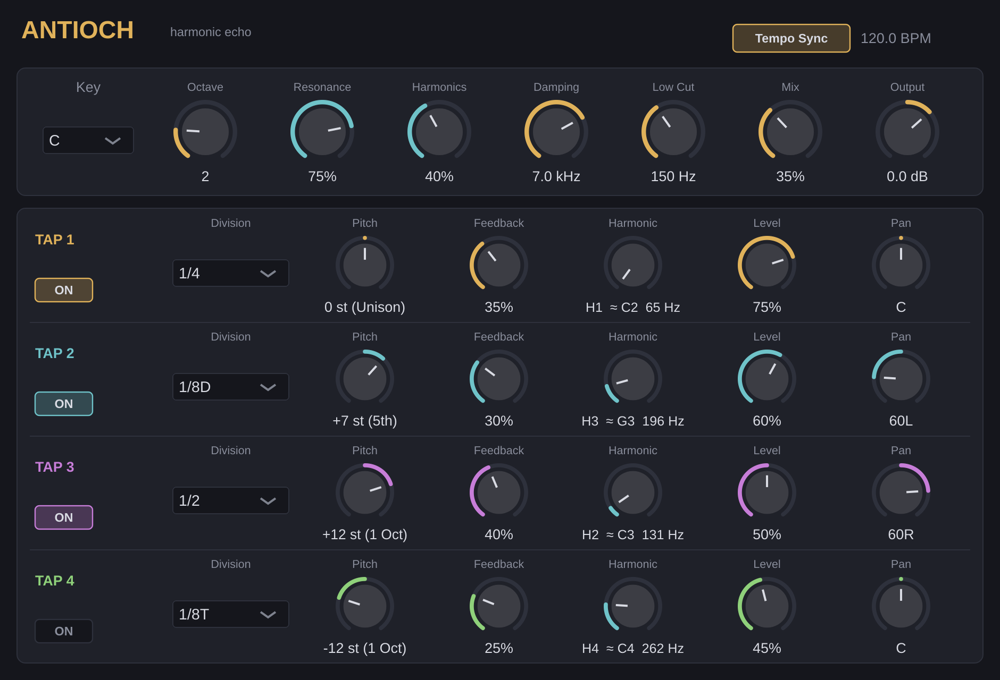

# Antioch: Harmonic Echo

A VST3 delay for FL Studio and other DAWs where every echo can be **pitch-shifted**,
**synced to tempo**, and **tuned to a key**. Each repeat feeds back through the pitch
shifter and a resonator tuned to a harmonic of your root note, so the tail climbs into
chords and rings in key instead of just fading out.



## How it works

Antioch has four independent echo taps. Each tap runs this chain:

```
input ─► delay ─► pitch shift ─► harmonic resonator ─► low cut ─► damping ─┬─► level/pan ─► wet out
           ▲                                                               │
           └──────────────────── feedback (soft-saturated) ◄───────────────┘
```

Because pitch shifting sits inside the feedback loop, a tap set to **+12 st** with
feedback gives a "shimmer" that rises an octave on every repeat. A **+7 st** tap stacks
fifths.

### Global controls

| Control | What it does |
|---|---|
| **Tempo Sync** | On: taps use note divisions synced to FL Studio's tempo. Off: taps use free times in ms. |
| **Key / Octave** | Root note for the harmonic resonators (e.g. C2 = 65 Hz). |
| **Resonance** | How long the resonators ring. Higher values give a more pitched, metallic tail. |
| **Harmonics** | Blend between the plain echo (0%) and the key-tuned resonator (100%). |
| **Damping** | High-frequency rolloff on each repeat (lower = darker, tape-like). |
| **Low Cut** | Removes low end from the echoes so repeats don't build up mud. |
| **Mix** | Dry/wet. At 50% both are at full level; above that the dry fades out. |
| **Output** | Final gain, −24 to +12 dB. |

### Per-tap controls

| Control | What it does |
|---|---|
| **On** | Enables the tap. Its tail rings out naturally when you switch it off. |
| **Division / Time** | Echo time: a note division (1/32 to 1 bar, including dotted and triplet) or 10–2500 ms. |
| **Pitch** | Interval applied to every repeat, −24 to +24 semitones. |
| **Feedback** | How many repeats. Saturation keeps high settings from blowing up. |
| **Harmonic** | Which harmonic of the root the resonator rings at (H1 = root, H2 = octave, H3 = octave + fifth…). The label shows the nearest note and frequency. |
| **Level / Pan** | Tap volume and stereo position. |

## Installing in FL Studio 26 (Windows)

1. Open the repository's **Actions** tab on GitHub, pick the latest successful **Build** run,
   and download **Antioch-Windows-VST3**. Version tags (`v0.1.0`, …) also attach the zip
   to a GitHub Release.
2. Unzip it and copy `Antioch.vst3` to `C:\Program Files\Common Files\VST3\`.
3. In FL Studio: **Options → Manage plugins → Find installed plugins**.
4. Add **Antioch** to a mixer insert slot.

On macOS, copy `Antioch.vst3` to `~/Library/Audio/Plug-Ins/VST3/`. The CI build is not
code-signed, so you may need to run `xattr -dr com.apple.quarantine ~/Library/Audio/Plug-Ins/VST3/Antioch.vst3`.

## Building from source

Requirements: CMake 3.22+, a C++17 compiler (Visual Studio 2022 on Windows, Xcode on macOS).
JUCE 8 is downloaded automatically at configure time.

```bash
cmake -B build -DCMAKE_BUILD_TYPE=Release
cmake --build build --config Release --target Antioch_VST3
# Result: build/Antioch_artefacts/Release/VST3/Antioch.vst3
```

There is also a `Antioch_Standalone` target for quick testing without a DAW.

### Tests

```bash
cmake -B build -DANTIOCH_BUILD_TESTS=ON
cmake --build build --target AntiochTests
./build/AntiochTests_artefacts/Release/AntiochTests test-output   # use xvfb-run on headless Linux
```

The tests check that the output stays finite and bounded at extreme settings, that tails
decay, that parameter automation doesn't break anything, and that state saves and reloads.
They also write example WAV renders and a UI snapshot to `test-output/`.

## Project layout

```
Source/
  Parameters.*        parameter IDs, ranges, defaults, display formatting
  DSP.h               delay line, pitch shifter, comb resonator, filters
  PluginProcessor.*   audio engine
  PluginEditor.*      UI and look-and-feel
Tests/RenderTest.cpp  offline test runner
.github/workflows/    Windows/macOS/Linux CI builds
```

## Licence note

JUCE is dual-licensed: AGPLv3, or a commercial JUCE licence. If you distribute Antioch
closed-source or sell it, you need a JUCE licence (there is a free tier for small
revenue). Otherwise, the project must be released under the AGPLv3.
